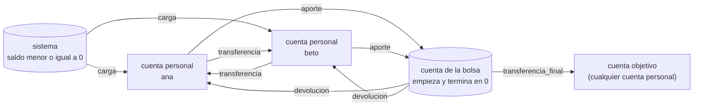

# README

> **Proyecto:** Cuadre
> **Autor/a:** Edy Martinez
> **Fecha:** 9 de Noviembre 2026

## Contexto y objetivo

Cuadre es una billetera digital simulada en pesos colombianos, hecha para el reto técnico de HabiCapital. Permite registrarse, cargar saldo, transferir a otros usuarios, ver el saldo y consultar el historial.

Mi funcionalidad propia son las **bolsas**: cobros en grupo donde cada participante paga su parte exacta a una cuenta común. La app divide el total sin perder un peso. Cuando todos pagan, el dinero se transfiere solo a la cuenta objetivo. Si la bolsa vence antes, se transfiere lo de quienes pagaron o se devuelve todo, según la política que el creador fijó al crearla.

El objetivo de la entrega fue uno solo: **que el sistema no pueda perder, crear ni mover mal un peso**, y poder demostrarlo. Por eso diseñé primero el modelo, las reglas y las pruebas, y dejé fuera todo lo que no ayudara a eso.

### Flujo del dinero



Cada flecha es una transacción con dos movimientos: −monto en el origen y +monto en el destino. La suma de los saldos de todas las cuentas es siempre cero.

## 01. Decisiones clave y por qué las tomé

### Decisión 1: Libro contable de partida doble

- **Qué decidí:** Todo lo que mueve valor es una transacción con origen y destino distintos, monto mayor que 0 y dos movimientos con signo. Una única cuenta de sistema es la contrapartida de las cargas y es la única que puede tener saldo negativo.
- **Por qué:** Nada aparece ni desaparece. Verificar que no se pierde un peso se reduce a verificar sumas. Cada transacción suma 0, cada saldo es la suma de sus movimientos y todos los saldos suman 0. Además, así se puede tener un historial de movimientos para el usuario, localizar los movimientos asociados y comprobar que su suma sea 0.
- **Alternativas consideradas:** Una fila por transferencia sin movimientos.

### Decisión 2: Bolsas con cuenta propia, política fija y creador que siempre participa

- **Qué decidí:** Cada bolsa tiene su propia cuenta, que empieza y termina en cero. Aportar, devolver y la transferencia final son transferencias normales del libro. La configuración (parte de cada uno, cuenta objetivo, fecha límite y política al vencer) no cambia después de crearla. El creador es siempre participante y paga el sobrante de la división.
- **Por qué:** La bolsa retiene el dinero hasta el final, así que nadie lo gasta antes y siempre se puede devolver. La división es exacta y determinista. Como la política no cambia, quien no esté de acuerdo puede retirarse antes de la fecha límite.
- **Alternativas consideradas:** Que cada pago llegue directo al creador; una cuenta por grupo para todas sus colectas; pagos parciales; bolsas reutilizables.
- **Trade-offs:** No se puede crear una bolsa para otros sin aportar. No hay pagos parciales ni cambio de configuración. Es un modelo más simple, pero también más rígido.

### Decisión 3: Nada se envía sin consentimiento

- **Qué decidí:** Cuando alguien se retira, los que ya pagaron pasan a `por_confirmar` y deben aceptar los términos nuevos (la meta bajó). Al vencer, quien no está en `pagado` pasa a `retirado` y se le devuelve su dinero. La transferencia final es automática y ocurre en la misma transacción del último aporte o de la última confirmación.
- **Por qué:** Un retiro cambia lo que recibe la cuenta objetivo, así que cambian los términos para quienes ya pagaron. Devolver a quien no aceptó es la opción que protege los fondos de cada participante.
- **Alternativas consideradas:** Tratar `por_confirmar` como `pagado` al vencer; que el creador confirme la transferencia final; no pedir confirmación.
- **Trade-offs:** Si los participantes no abren la app antes de la fecha límite, muchas bolsas terminan devolviendo todo. Lo compensé con un aviso al iniciar sesión, sin notificaciones por correo ni push.

### Decisión 4: Idempotencia con clave del cliente

- **Qué decidí:** Cargar, transferir, aportar y retirarse exigen `Idempotency-Key` y se guarda con el hash de la petición. Misma clave y mismo hash devuelven el resultado original. Misma clave con otro hash da 409. La clave se asocia a la cuenta personal, no a la sesión.
- **Por qué:** Un reintento con una sesión nueva no debe mover el dinero dos veces.
- **Trade-offs:** Crear bolsa, cancelar y confirmar no llevan clave porque no mueven dinero por sí mismas. Un reintento tras perder la respuesta puede recibir 409 aunque la operación sí se hizo. Supuesto: el frontend no reintenta solo esas operaciones.

### Decisión 5: Capas estrictas y el servicio como dueño de la transacción

- **Qué decidí:** La API solo valida la forma y delega. `domain/` tiene reglas puras. El servicio decide, escribe y confirma, y solo el servicio del libro inserta movimientos y cambia saldos.
- **Por qué:** Para mantener una arquitectura por capas, aquí cada capa únicamente conoce la existencia de la siguiente. Por ejemplo, un servicio se comunica con `domain`, pero `domain` no sabe que existe el servicio.
- **Trade-offs:** Más archivos y más disciplina. A cambio, las pruebas violan una regla por petición y no dependen del orden de los errores.

### Decisión 6: Solo el barrido liquida, y la deuda sale del libro

- **Qué decidí:** El barrido liquida en tres pasos (preparar, devolver y cerrar), cada uno en su propia transacción. Lo que se le debe a cada participante se recalcula desde el libro (aportes menos devoluciones), sin contadores aparte.
- **Por qué:** Sigue un pipeline que asegura un proceso efectivo: preparar cambia el estado de los usuarios `por_confirmar` o `pendiente`; devolver calcula lo que se le debe a cada participante y hace la transacción; después, cuando la bolsa queda en 0, se cierra.
- **Trade-offs:** Hay un estado intermedio (`liquidando`) con saldo en la bolsa. Depende del barrido de las bolsas que el proceso empiece y que la bolsa termine de cerrarse.

### Decisión 7: Montos enteros estrictos y una regla simple para los errores

- **Qué decidí:** Los montos son enteros en pesos, `BIGINT` en la base y enteros JSON en la API. Pydantic estricto rechaza `1000.0`, `"1000"`, `1e3` y `true`. Regla de HTTP: 422 si la petición es inválida por sí sola, 409 si es válida pero choca con el estado actual (por ejemplo, saldo insuficiente).
- **Por qué:** Una sola forma de entrada es más fácil de probar y nunca se redondea en silencio. El criterio de 422 contra 409 es fácil de aplicar y de probar.
- **Alternativas consideradas:** Aceptar texto numérico o decimales exactos; clasificar los errores por si el usuario puede corregirlos.
- **Trade-offs:** Los saldos no tienen tope, así que, en teoría, un saldo podría pasar 2^53, pero no se podría llegar a este valor.

### Decisión 8: Autenticación sencilla y declarada como límite

- **Qué decidí:** Login con usuario y contraseña. La contraseña se guarda con scrypt. El token se genera y se guarda solo como SHA-256, expira a los 20 minutos y hay una sola sesión activa por usuario.
- **Por qué:** Permite comprobar que nadie mueve dinero ajeno sin agregar dependencias, y si alguien lee la base no obtiene contraseñas ni tokens usables.
- **Trade-offs:** No soy experto en seguridad: no hay límite de intentos y el frontend guarda el token.

## 02. Cómo sé que el sistema no pierde un peso

### Qué puede salir mal y cómo lo protejo

| Riesgo                                       | Cómo lo protejo                                                                                      | Evidencia                                                 |
| -------------------------------------------- | ---------------------------------------------------------------------------------------------------- | --------------------------------------------------------- |
| Montos decimales o redondeo                  | Enteros de punta a punta; Pydantic estricto                                                          | Pruebas de la API con cada forma inválida                 |
| Una transacción crea o pierde dinero         | Partida doble; el servicio verifica la suma cero antes de confirmar y, si falla, revierte todo       | Invariantes L1, L2 y L4                                   |
| Saldo distinto de la suma de sus movimientos | El saldo se actualiza en la misma transacción que el movimiento; `CHECK` de saldo por tipo de cuenta | Invariante L3                                             |
| Saldo negativo por operaciones simultáneas   | Bloqueo de cuentas, `populate_existing` y `saldo = saldo + :delta`                                   | 100 transferencias simultáneas desde una cuenta           |
| Doble cobro por un reintento                 | Clave de idempotencia                                                                                | Dos hilos con la misma clave; misma clave con otro cuerpo |
| Transferencia final o devolución duplicadas  | Bloqueo de la bolsa, deuda recalculada desde el libro e índices únicos parciales                     | Barrido ejecutado dos veces                               |
| Bolsa cerrada con saldo                      | Solo se cierra con saldo 0, comprobado antes del cierre                                              | B8 y `_cerrar_en_cero`                                    |

### Evidencia de que funciona

- **Pruebas realizadas:** Unitarias del dominio (con Hypothesis para las propiedades de la división), de servicios y de la API contra PostgreSQL real (sin simular la base), de concurrencia con hilos y pruebas unitarias del frontend.
- **Invariantes en cada prueba:** Las 19 invariantes corren al final de toda prueba que toca la base.
- **Escenarios cubiertos:**
  - Ana con $1.000.000 hace 100 transferencias de $20.000 en 20 hilos: exactamente 50 aciertos y 50 `saldo_insuficiente`, saldo final 0 y cero reintentos.
  - 20 transferencias ana a beto y 20 beto a ana a la vez, para forzar el solapamiento.
  - Los choques de bolsas de SPEC 8.4 (último aporte contra retiro, cancelación y vencimiento; dos aportes finales simultáneos; última confirmación contra retiro), en 9 filas con 10 repeticiones cada una.
  - Barrido ejecutado dos veces, interrumpido y retomado, y una bolsa fallida que no detiene a las demás.
- **Limitaciones inherentes:**
  - Las pruebas las diseñó la IA y yo las adopté tras entenderlas; puede haber huecos que un experto en pruebas vería.

## 03. Qué dejé fuera y por qué

### Recortes durante la construcción

Iba atrasado respecto al plan y tuve que aplicar recortes en la implementación.
**Recorte 1:** cancelar siempre devuelve todo: La cancelación ignora la política de transferir. El estado `cancelada` existe en el esquema, pero no se produce. Se pierde la posibilidad de cancelar y aun así transferir lo de quienes confirman.
**Recorte 2:** el barrido se ejecuta con `make vencer`: Ningún hilo dentro de la API revisa cada 60 segundos. Las bolsas vencidas no se liquidan solas; hay que correr el comando. `procesar_vencidas` tiene las mismas pruebas, solo cambia quién la dispara. En una demo, el vencimiento exige un paso manual.

### Fuera de alcance desde el diseño

| Fuera de alcance                                                        | Motivo                                                 | Impacto                                                                        |
| ----------------------------------------------------------------------- | ------------------------------------------------------ | ------------------------------------------------------------------------------ |
| Cobros recurrentes y creación de cobros con IA                          | Una sola funcionalidad propia, bien hecha, en 72 horas | La bolsa es de un solo uso                                                     |
| Políticas avanzadas (exigir el total original, cancelar ante un retiro) | Modelo básico con una sola política                    | La meta puede bajar y la cuenta objetivo recibe menos                          |
| Reverso de una transferencia                                            | No se pidió                                            | Un error se corrige a mano                                                     |
| Verificación de identidad y cumplimiento regulatorio                    | Fuera del reto                                         | Alguien puede registrar la cédula de otra persona                              | Verificación con un tercero |
| Límite de intentos y defensa de enumeración en el login                 | Falta de experiencia en seguridad y de tiempo          | Se pueden adivinar contraseñas a fuerza bruta y averiguar qué usuarios existen |
| Notificaciones por correo o push                                        | El aviso al iniciar sesión alcanza para el reto        | Se puede perder la fecha límite                                                |

## 04. Qué haría distinto con más tiempo

1. **Implementar el hilo del barrido.** Hoy las bolsas vencidas esperan a que alguien corra `make vencer`. Un barrido automático haría que el producto se comportara como se diseñó.
2. **Escribir `DECISIONS.md` y `AI_LOG.md` durante la construcción y revisar la implementación a profundidad.** Pasé muchas horas diseñando a mano y no pude estar al pendiente de la implementación de esta arquitectura. Con más tiempo, habría anotado las decisiones en el momento y con mis palabras.
3. **Endurecer la seguridad.** Implementar defensa contra la enumeración por tiempo, un límite de intentos y guardar el token fuera del front para reducir el riesgo.
4. **Recuperar la cancelación con política de transferir.** Es el recorte que más funcionalidad quitó, y el dominio ya lo soporta.
5. **Alinear `SPEC.md` y `AGENTS.md` con los recortes**, para que los documentos y el código cuenten la misma historia.
6. **Desarrollar más políticas de bolsas y su automatización.** Como mencioné, tuve que recortar las políticas de las bolsas para diferentes casos. Además, me tocó dejar fuera una opción para automatizar las bolsas por mes.

## 05. Qué NO sé

- **Seguridad.** Seguí recomendaciones conocidas, pero no sé qué huecos vería alguien con conocimientos en seguridad.
- **Pruebas.** La estrategia de pruebas la propuso la IA y la adopté después de entenderla. No sé qué casos de concurrencia o de datos extraños se me escapan.
- **Qué tan bien entiendo todo el código.** Por la falta de tiempo, la implementación de la arquitectura fue delegada en gran medida a la IA. Yo solo intervine en la toma de decisiones sobre el manejo de las situaciones.

## 06. Supuestos que hice y por qué

| Supuesto                                      | Por qué lo hice                        | Qué pasa si es falso                                                   | Cómo lo validaría    |
| --------------------------------------------- | -------------------------------------- | ---------------------------------------------------------------------- | -------------------- |
| Los montos son pesos colombianos sin centavos | Simplifica el modelo y evita redondeos | Habría que guardar centavos como enteros y fijar una regla de redondeo | Preguntar al negocio |

## 07. Cómo usé IA

### Herramientas y dinámica

- **Herramientas utilizadas:** Claude (chat) para el diseño y la revisión, Claude Code como agente de código.
- **Etapas en las que la usé:** Diseño, especificación, implementación, pruebas, revisión y documentación. Prácticamente todo el código lo escribieron los agentes.
- **Qué le pedía:** Primero, que diseñara conmigo la arquitectura y escribiera el `SPEC.md` por bloques, cuestionando mis respuestas y señalando riesgos con el dinero. Después, tarea por tarea (T1 a T18), que planeara, escribiera las pruebas y las implementara.
- **Qué decidía yo:** El alcance y las reglas (las bolsas, la política fija, `por_confirmar`, los topes y los límites), qué se recortaba y por qué, y si un cambio se aceptaba. Pasé muchas horas definiendo la arquitectura y el modelo de datos a mano antes de empezar a construir.
- **Cómo verificaba sus respuestas:** Con las pruebas contra PostgreSQL real, con las 19 invariantes al final de cada prueba, con `make check`, quitando protecciones a propósito para ver que las pruebas fallaran, y con una auditoría del SPEC hecha por otro modelo.
- **Qué no hice:** No escribí el código línea por línea. Mi intervención en la construcción fue tomar las decisiones de diseño y llevar el ciclo tarea por tarea.

### Un error o casi-error de la IA

En la etapa de planeación de la arquitectura, correspondiente al modelo de datos y a la construcción del diagrama entidad/relación, el modelo me presentó un diagrama que no correspondía a la arquitectura planteada anteriormente y que complejizaba la implementación. Además, el diagrama propuesto añadía problemas a la hora de asegurar la integridad de las transacciones.
El error surgió en la planeación. Por eso, cada propuesta era revisada por mí y analizada profundamente para verificar el sentido y la idoneidad de la arquitectura. Gracias a esto, me di cuenta de los defectos del diseño y me encargué de reconstruir las entidades, los atributos y las relaciones.

## 08. Qué aprendí

### Algo nuevo para mí

### Qué me llevo

Que la etapa de planeación es la más importante. Con una buena base, el resultado de cada etapa va a ser mejor. Además, aprendí a usar Docker, FastAPI y el flujo básico para trabajar con modelos. Por otro lado, también aprendí a no confiar por completo en los modelos, ya que pueden tener sesgos y errores puntuales; esto me obliga a revisar cada parte de la arquitectura.

## Cómo ejecutar y verificar

### 1. Requisitos

- Docker con Docker Compose v2 y `make`.
- Node.js 24.19.0 (con npm 12.0.2) para el frontend. El frontend usa Angular 22.2.5, fijado en `frontend/package-lock.json`.
- Python 3.12 o superior, solo si quieres correr `make test` en el host.

Configuración inicial:

```bash
cp .env.example .env    # completa POSTGRES_USER, POSTGRES_PASSWORD y POSTGRES_DB,
                        # y usa los mismos valores en DATABASE_URL y TEST_DATABASE_URL
```

### 2. Levantar todo

```bash
make up      # PostgreSQL y la API; la API corre alembic upgrade head al arrancar
make seed    # datos de demo
make front   # instala el frontend con npm ci si hace falta y lo sirve (déjalo corriendo)
```

| Qué                       | URL                                                                                               |
| ------------------------- | ------------------------------------------------------------------------------------------------- |
| API                       | <http://localhost:8000>                                                                           |
| Documentación interactiva | <http://localhost:8000/docs> (inicia sesión con `POST /sesiones` y usa el token en **Authorize**) |
| Frontend                  | <http://localhost:4200>                                                                           |

### 3. Usuarios de demo

`ana`, `beto`, `carla` y `olga`. La contraseña de todos es `demo-cuadre-2026`.

`make seed` hace lo siguiente:

- Carga $200.000 a ana, beto y carla.
- Crea la bolsa `cena`: $90.000 entre ana, beto y carla ($30.000 cada uno), cuenta objetivo olga, vence en 7 días y al vencer envía lo pagado. beto ya aportó.
- Crea la bolsa `vence_pronto`: $20.000 entre beto y carla ($10.000 cada uno), vence 3 minutos después y al vencer devuelve todo. carla ya aportó.

Se puede correr varias veces: lo que ya existe se reporta y no se duplica. Los montos de abajo suponen una base recién sembrada.

### 4. Recorrido manual

Para repetir la demo desde cero: `docker compose down -v`, `make up`, `make seed` (`down -v` borra todos los datos). Los pasos 5 y 7 dependen de una base recién sembrada: con datos de una corrida anterior, los saldos no coinciden, y `vence_pronto` puede haber vencido ya.

En <http://localhost:4200>:

1. **Iniciar sesión como ana.** Entras a _Mi cuenta_. Arriba aparece la alerta rosada **Bolsas que esperan tu acción**: "cena: falta tu aporte de $30.000".
2. **Ver saldo e historial.** El saldo es **$200.000**. El historial muestra una `carga` desde `sistema` por **$200.000**.
3. **Transferir a beto.** En _Transferir_, escribe destino `beto` y monto `20000`. Aparece "Operación realizada.", el saldo baja a **$180.000** y el historial muestra una `transferencia` a beto por **-$20.000**. Si escribes `20.000` o `20000.5`, el formulario rechaza el monto sin enviarlo.
4. **Ver la bolsa cena.** En _Mis bolsas_, abre `cena` (estado ABIERTA, tu estado PENDIENTE). Verás:
   - total $90.000, meta $90.000, aportado $30.000 y transferido —;
   - participantes: 3; pagados: 1; pendientes: 2;
   - tu parte: $30.000;
   - botones _Aportar $30.000_, _Retirarme_ y _Cancelar bolsa_. Este último aparece solo porque ana es la creadora.
5. **Aportar como carla.** Sal de la sesión y entra como `carla`.
   - Al entrar, el aviso muestra `cena` (pendiente, $30.000). Si `vence_pronto` no ha vencido, no aparece, porque carla ya pagó esa.
   - Abre `cena` y pulsa _Aportar $30.000_. Antes de enviar, el frontend vuelve a consultar la bolsa y comprueba que la meta no cambió.
   - Resultado: aportado **$60.000**, pagados 2, y el estado de carla pasa a PAGADO.
   - En _Mi cuenta_, el saldo de carla es **$160.000** ($200.000 − $10.000 de `vence_pronto` − $30.000 de `cena`), y el aviso ya no menciona `cena`.
6. **Ver de nuevo el aviso de pendientes.** Entra como ana: el aviso sigue mostrando `cena`, porque ana aún no aporta. Si ana aporta $30.000, todos quedan en `pagado` y en esa misma transacción se transfieren los **$90.000** a olga. La bolsa pasa a CERRADA, con transferido $90.000.
7. **Vencimiento y devolución.** Espera 3 minutos desde `make seed` y corre:

   ```bash
   make vencer
   ```

   `vence_pronto` se liquida. beto (pendiente) pasa a retirado sin movimientos, y carla recibe la devolución de sus **$10.000**. Como carla, su saldo sube a **$170.000** y el historial muestra una `devolucion` desde la bolsa por **$10.000**. La bolsa queda CERRADA.

### 5. Verificación

```bash
make check                                 # invariantes del libro contable (corre dentro del contenedor api)
make test                                  # opcional: suite completa del backend (usa la base cuadre_test)
cd frontend && npx ng test --watch=false   # pruebas unitarias del frontend
```

Para `make test` necesitas el entorno virtual del backend:

```bash
cd backend && python3 -m venv .venv && .venv/bin/pip install -r requirements-dev.txt && cd ..
```

Para aplicar las migraciones a mano desde el host: `cd backend && .venv/bin/alembic upgrade head`.

El barrido de vencidas se ejecuta con `make vencer`, no con un hilo automático (recorte 3, `DECISIONS.md`).

### 6. Detener y limpiar

```bash
# Ctrl+C en la terminal de make front para detener el frontend
docker compose down      # detiene la API y la base; los datos se conservan
docker compose down -v   # además borra el volumen: se pierden todos los datos
```
