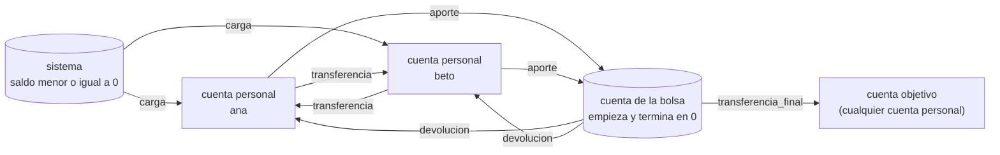
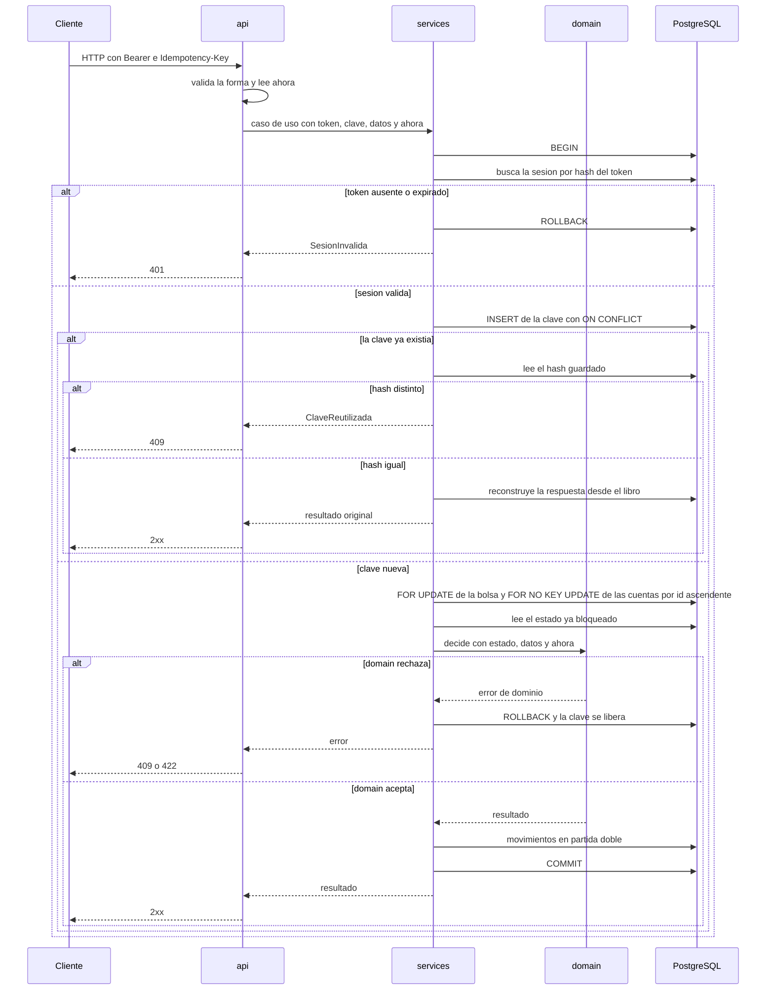
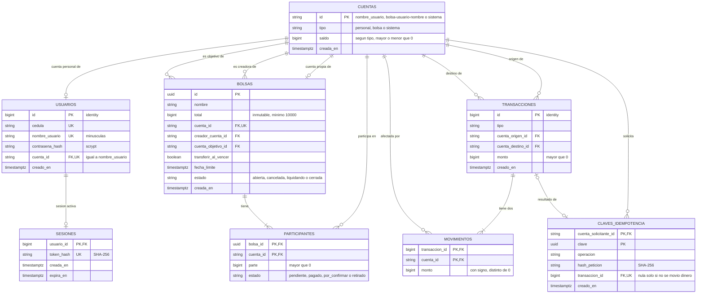
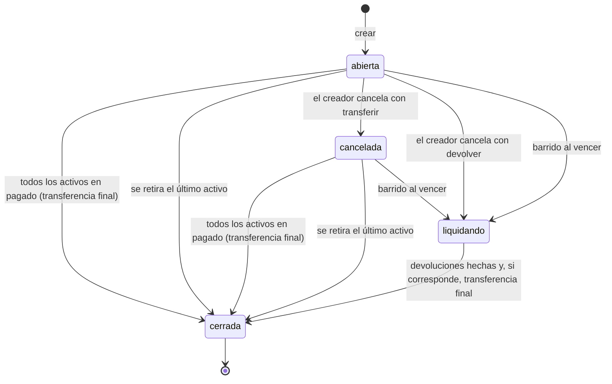
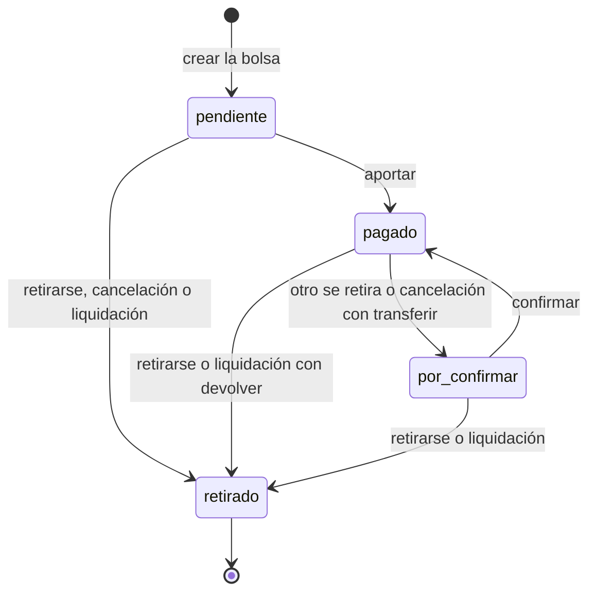

# SPEC de Cuadre

> Fuente de verdad del producto. Si `AGENTS.md` y este archivo se contradicen, se detiene el trabajo y se resuelve.
>
> **Estado:** los once bloques están cerrados.

## 0. Visión general

Cuadre es una billetera simulada en pesos colombianos con un libro contable de partida doble. Todo peso sale de una cuenta y llega a otra, y la suma de los saldos de todas las cuentas es siempre cero. La funcionalidad propia son las bolsas: cobros en grupo con una cuenta común, división exacta y transferencia final a una cuenta objetivo.

### 0.1 Flujo del dinero



- Cada flecha es un tipo de transacción (3.5): dos movimientos, −monto en el origen y +monto en el destino.
- La cuenta de sistema es la contrapartida de las cargas. Su saldo es lo que el sistema les debe a los usuarios.
- La cuenta de una bolsa solo recibe aportes y solo entrega devoluciones o la transferencia final.
- Los estados de la bolsa y del participante están en 6.4.

---

## 1. Alcance y supuestos

### 1.1 Moneda y montos

- Todos los montos son enteros en pesos colombianos (COP), sin centavos.
- La API solo acepta enteros JSON. `1000.0`, `"1000"` y `1e3` se rechazan con 422, sin conversión ni redondeo.
- El error de formato es responsabilidad de quien envía la petición, sea el frontend o un cliente directo de la API.

### 1.2 Usuarios y cuentas

- Cada usuario tiene exactamente una cuenta de tipo `personal`, creada en la misma transacción que el usuario.
- El usuario se identifica con su `nombre_usuario`, que se guarda en minúsculas y solo admite letras sin tilde, números y guion bajo (`[a-z0-9_]`).
- La cédula es única y solo sirve para saber si una persona ya tiene cuenta. Nunca se usa para iniciar sesión.
- Tipos de cuenta: `personal`, `bolsa` y `sistema`.
- No hay retiros de dinero hacia fuera del sistema. Si se agregaran, serían un movimiento de la cuenta del usuario hacia la cuenta de sistema, con las mismas validaciones de una transferencia.

### 1.3 Cuenta de sistema

- Existe una sola, creada por migración. Es la contrapartida de toda carga de saldo.
- Cargar $X genera dos movimientos: +X en la cuenta del usuario y −X en la cuenta de sistema.
- Su saldo es el negativo de todo lo cargado: lo que el sistema les debe a los usuarios. Por eso la suma de los saldos de todas las cuentas es siempre cero.
- Restricciones de saldo:
  - Cuenta `sistema`: `saldo <= 0`.
  - Cuentas `personal` y `bolsa`: `saldo >= 0`.
- Se bloquea con `SELECT ... FOR NO KEY UPDATE` como cualquier otra cuenta, así que las cargas simultáneas se procesan en fila. Es una limitación aceptada por tiempo y se declara como mejora futura.

### 1.4 Autenticación

**Contraseñas y tokens: resumen**

| | Contraseña | Token de sesión |
| --- | --- | --- |
| Quién lo crea | El usuario, al registrarse | El servidor, en cada login |
| Cómo se genera | — | `secrets.token_urlsafe(32)`: 32 bytes aleatorios. Nunca el módulo `random`, que es predecible |
| Cómo se guarda | scrypt (hash lento) con sal, en `usuarios.contrasena_hash` | SHA-256 en hexadecimal (hash rápido), en `sesiones.token_hash` |
| Por qué ese hash | Las personas eligen contraseñas adivinables; un hash lento hace muy caro probar millones de ellas si alguien roba la base | El token es aleatorio y larguísimo; no hay nada que adivinar, así que basta un hash rápido |
| Se devuelve al cliente | Nunca | Una sola vez, en la respuesta del login |
| Aparece en logs o errores | Nunca | Nunca |

**Contraseñas**
- Longitud entre 8 y 128 bytes UTF-8, validada por la API. El máximo evita que una contraseña enorme convierta scrypt en un ataque a la CPU.
- **Al registrarse:**
  1. Se genera una sal aleatoria de 16 bytes con `secrets.token_bytes(16)`.
  2. Se calcula `hashlib.scrypt(contraseña en UTF-8, salt=sal, n=N, r=r, p=p, maxmem=..., dklen=32)`.
  3. Se guarda en `contrasena_hash` un solo texto con el algoritmo, los parámetros, la sal y el hash, por ejemplo `scrypt$131072$8$1$<sal en base64>$<hash en base64>`.
- **Al iniciar sesión:**
  1. Se lee el texto guardado y se separan los parámetros, la sal y el hash.
  2. Se recalcula scrypt con la contraseña recibida, usando esos mismos parámetros y esa sal.
  3. Se compara el resultado con el hash guardado usando `hmac.compare_digest`, que tarda lo mismo sin importar dónde difieran. Nunca con `==`.
- **Parámetros:** configurables. Por defecto, los mínimos que recomienda OWASP: N = 2^17, r = 8 y p = 1, con `maxmem` suficiente (unos 128 MiB por hash). En las pruebas se usa N = 2^14 para que la suite sea rápida. Como los parámetros se guardan junto a cada hash, se pueden cambiar sin invalidar las contraseñas existentes.

**Sesiones y tokens**
- **Al iniciar sesión:** se genera el token con `secrets.token_urlsafe(32)`, se calcula su SHA-256 en hexadecimal (64 caracteres, como exige `ck_sesiones_hash`) y se guarda solo ese hash. El token se devuelve una sola vez al cliente y el servidor no lo conserva.
- **En cada petición:** se calcula el SHA-256 del token recibido y se busca la sesión por `token_hash`, que tiene índice único. Si no existe o expiró, 401.
- El token viaja en cada petición en la cabecera `Authorization: Bearer <token>`.
- Una sola sesión activa por usuario: un login nuevo reemplaza la sesión anterior. La tabla de sesiones tiene `UNIQUE` sobre el usuario, para que dos logins simultáneos no dejen dos tokens válidos. El último login siempre tiene el token activo.
- El token expira 20 minutos después del login. Las peticiones normales no extienden el plazo.
- Un token está vigente mientras `ahora < expira_en`.
- Renovación explícita: mientras el token siga vigente, el usuario puede pedir que se restablezcan los 20 minutos (la app le ofrece un botón para continuar cuando queda poco tiempo). La renovación conserva el mismo token y mueve su expiración a `ahora + 20 minutos`.
- Un token expirado no se puede renovar: el usuario inicia sesión otra vez y recibe un token nuevo.
- La expiración se compara con `ahora` (regla 10 del dinero), sin procesos que borren tokens.
- Cerrar sesión borra la sesión.
- Token ausente, inexistente o expirado: 401.

**Idempotencia y sesiones**
- La clave de idempotencia se asocia a la cuenta personal de quien hace la petición, no a la sesión: `UNIQUE (cuenta_solicitante_id, clave)`.
- Si el token expira entre una petición y su reintento, el cliente inicia sesión de nuevo, reintenta con la misma clave y recibe el resultado original sin mover dinero otra vez.

### 1.5 Límites

| Límite | Valor |
| --- | --- |
| Tope por carga, transferencia o aporte (operaciones que inicia un usuario) | $50.000.000 |
| Tope de devoluciones y de la transferencia final (movimientos que deriva el sistema) | Sin tope |
| Saldo máximo por cuenta | Sin tope |
| Participantes por bolsa | Entre 2 y 50 (constante configurable) |
| Total mínimo de una bolsa | $10.000, validado solo al crearla |
| Parte máxima por participante | $50.000.000, incluido el sobrante del creador |
| Total máximo de una bolsa | ($50.000.000 − $10.000) × participantes ($2.499.500.000 con 50) |

- Con estos límites cada parte es de al menos $200, así que ninguna parte es cero.
- Los retiros bajan la meta, pero nunca la dejan en cero mientras quede un participante activo. Si se retiran todos, la bolsa se cierra sin mover dinero (6.6).
- El tope por operación es un supuesto de escala, no una garantía. Sin saldo máximo, un saldo podría en teoría pasar 2^53 (el límite de enteros exactos en JavaScript) tras cientos de millones de cargas máximas. Los montos viajan como enteros JSON también en las respuestas (9.1).
- Una devolución nunca se rechaza por tope ni por saldo máximo.

### 1.6 Cuenta objetivo de las bolsas

- Se fija al crear la bolsa y no cambia.
- Puede ser cualquier cuenta `personal`, incluida la del creador. Nunca una cuenta `bolsa` ni la de sistema.
- Cada invitado ve los términos antes de entrar: su parte, el total, la cuenta objetivo, la fecha límite y la política de vencimiento.

### 1.7 Cancelación y vencimiento con devolución

- Se ejecutan como una transacción por participante, todas seguidas y sin esperar confirmación.
- Cada devolución respeta el orden de bloqueo: primero la fila de la bolsa y después sus dos cuentas por id ascendente.
- Lo que se le debe a cada participante se calcula desde el libro (aportes menos devoluciones), así que una devolución repetida o retomada no puede pagar de más.
- El estado intermedio con saldo (`liquidando`) y la reanudación tras una caída se definen en la sección 7.

### 1.8 Preguntas del bloque 1 ya resueltas

- **Credenciales:** el login usa `nombre_usuario` y contraseña. No hay correo. La cédula solo garantiza que una persona no tenga dos cuentas (1.2).

---

## 2. Arquitectura

### 2.1 Capas

| Capa | Responsabilidad | No puede |
| --- | --- | --- |
| `api/` | Extrae el token y `Idempotency-Key` de las cabeceras, valida la forma (Pydantic estricto: tipos, enteros JSON, longitud de la contraseña, caracteres del nombre de usuario, conversión a minúsculas), lee `ahora`, entrega la sesión de base de datos y traduce excepciones a HTTP | Abrir transacciones, consultar, decidir reglas, hacer `commit` |
| `services/` | Dueño de la transacción: autentica, verifica la idempotencia, bloquea, lee el estado ya bloqueado, llama a `domain/`, escribe en el libro, confirma y reintenta. El servicio del libro contable es el único que inserta movimientos y cambia saldos | Importar FastAPI, leer la hora |
| `domain/` | Reglas puras: división, estados de la bolsa, validación de montos y tope, transferencia a uno mismo, permisos con ids ya leídos | Importar SQLAlchemy o FastAPI, leer la hora |
| `db/` | Modelos, sesión, migraciones y restricciones | Lógica de negocio |

- La API solo recibe, valida la forma y delega. El servicio decide y escribe.
- La API valida que los datos lleguen bien formados. `domain/` valida las reglas de negocio, como que el monto sea positivo y no pase el tope. Una misma regla no se valida en las dos capas.
- Los únicos puntos que leen el reloj son la API y el hilo del barrido. Todo lo demás recibe `ahora`.
- Una prueba verifica que `domain/` no importa `sqlalchemy` ni `fastapi`, y que `services/` no importa `fastapi`.
- Saldo e historial también pasan por el servicio, en transacciones de solo lectura.

### 2.2 Flujo de una petición



Si el primer intento con una clave aún no confirma, el duplicado espera en el `INSERT` (lo hace el índice único) y después ve el resultado. Si el primero revierte, el duplicado inserta la clave y ejecuta la operación.

Las reglas de `domain/` que no dependen del estado (monto y tope, transferencia a uno mismo) pueden revisarse antes de bloquear, para no retener bloqueos por una petición que ya se sabe inválida.

### 2.3 Transacción y reintentos

- Una sesión de base de datos por petición, creada por la API y nunca compartida entre hilos. La API no hace `commit`.
- Cada caso de uso, incluidas las lecturas, abre su transacción y la confirma o revierte. Aislamiento `READ COMMITTED`.
- La autenticación es el primer paso dentro de la transacción: sin sesión válida, 401 y `ROLLBACK`.
- Un envoltorio repite el caso de uso completo, autenticación incluida, solo ante `40P01` y `40001`, máximo 3 veces. Si se agotan: 503 `reintentos_agotados`, y el cliente puede repetir con la misma clave.
- El envoltorio registra cada reintento (caso de uso y código de error) en el log y en un contador que las pruebas pueden leer. Un reintento por `40P01` significa que se rompió el orden de bloqueo: las pruebas de concurrencia exigen cero (10.4).
- Los errores de negocio y de validación no se reintentan.

### 2.4 Orden dentro de una operación

1. Sesión, solo lectura, sin bloqueo.
2. Clave de idempotencia, con `INSERT ... ON CONFLICT`.
3. Fila de la bolsa, con `FOR UPDATE`, si la operación toca una.
4. Cuentas por id ascendente, con `FOR NO KEY UPDATE`, incluida la de quien paga.
5. Leer el estado, decidir en `domain/`, escribir en el libro y confirmar.

- Las cuentas se bloquean con `FOR NO KEY UPDATE` porque su id nunca cambia. Protege el saldo igual que `FOR UPDATE`, pero no choca con el `FOR KEY SHARE` que toman las llaves foráneas al insertar filas que referencian la cuenta (8.1). La fila de la bolsa sigue con `FOR UPDATE`: después de crearla, ninguna fila nueva la referencia.
- Las cuentas se bloquean con una sentencia por cuenta, en orden ascendente, después de quitar repetidos (por ejemplo, cuando quien paga es también la cuenta objetivo). Así el orden no depende de cómo PostgreSQL ejecute un `ORDER BY` con bloqueo.
- El saldo de la cuenta de una bolsa se puede leer con solo el bloqueo de la fila de la bolsa, porque todo lo que mueve esa cuenta pasa antes por ese bloqueo. Para escribir en ella, la cuenta se bloquea igual que cualquier otra.
- Toda lectura con bloqueo usa `populate_existing`. SQLAlchemy no sobrescribe un objeto que ya está en la sesión: si la cuenta se cargó antes (por ejemplo, al autenticar), la fila quedaría bloqueada pero el objeto conservaría el saldo viejo, y dos transferencias simultáneas podrían crear dinero. En SQLAlchemy, `FOR NO KEY UPDATE` se escribe `with_for_update(key_share=True)`; `with_for_update()` sin parámetros genera `FOR UPDATE`.
- El saldo solo se modifica con `UPDATE cuentas SET saldo = saldo + :delta`, que PostgreSQL calcula sobre la fila actual. Nunca se escribe un saldo calculado en Python. Si la lectura fallara, el saldo igual quedaría correcto y `ck_cuentas_saldo` rechazaría uno negativo.
- Primero se bloquean todas las filas que la operación va a usar, después se leen y al final se modifican. Nada que decida la operación se lee antes de bloquearlo.
- Nunca se bloquean dos bolsas en una misma transacción. Los ciclos solo podrían aparecer si algo rompe este orden.

### 2.5 Idempotencia

- El cliente genera un UUID v4 por cada intención del usuario y lo reutiliza en los reintentos. Viaja en `Idempotency-Key` y es obligatoria en toda operación de usuario que puede mover dinero (`cargar`, `transferir`, `aportar` y `retirarse`). Si falta: 400 `falta_clave_idempotencia`.
- Se guarda `UNIQUE (cuenta_solicitante_id, clave)`, el hash SHA-256 de (operación + ids de la ruta + cuerpo en forma canónica) y la referencia a la transacción del libro. La cuenta solicitante ya está en la restricción, así que no entra en el hash.
- La clave y la transacción son cosas distintas. La clave registra la intención del usuario y siempre se guarda cuando la operación confirma. La transacción solo existe si se movió dinero.
- Hoy el único caso que confirma sin mover dinero es retirarse sin haber pagado: la clave queda con `transaccion_id` nulo y el reintento se responde desde el estado del participante.
- `confirmar` no lleva clave: por sí misma no mueve dinero, y si completa la bolsa, la transferencia final es del sistema. Una confirmación repetida recibe 409 `estado_invalido` (6.7).
- Misma clave y mismo hash: se devuelve el resultado original, reconstruido desde el libro (o desde el estado del participante, si no hubo transacción). Nunca un error.
- Misma clave y otro hash: 409 `clave_reutilizada`.
- La clave solo persiste si la transacción confirma. Si la operación se rechaza y revierte, la clave queda libre.
- La verificación es un `INSERT ... ON CONFLICT`, nunca un `SELECT` seguido de un `INSERT`: la restricción `UNIQUE` es lo que cierra la carrera entre peticiones simultáneas.
- Se usa `INSERT ... ON CONFLICT DO NOTHING RETURNING clave`. Si devuelve una fila, la clave es nueva y la operación se ejecuta. Si no devuelve nada, la clave ya existía y se lee la fila guardada para comparar el hash.
- `Idempotency-Key` acepta cualquier UUID válido. Que sea v4 es responsabilidad del cliente, porque la versión no cambia nada para el servidor.
- Las operaciones que origina el sistema (devoluciones del barrido y transferencia final) no llevan clave (3.4).

### 2.6 Errores y HTTP

**Regla no negociable.** Si la petición es inválida por sí sola, sin importar el estado de ningún recurso, es **422**. Si la petición es válida pero choca con el estado actual de un recurso o con una regla que depende de ese estado, es **409**. Las dos categorías no se mezclan.

Todos los errores salen como `{"codigo": "...", "mensaje": "..."}`. El frontend y las pruebas usan `codigo`, no el número ni el texto.

| Situación | HTTP | `codigo` |
| --- | --- | --- |
| Forma inválida (decimal, texto, falta un campo, contraseña fuera de longitud, nombre de usuario con caracteres no permitidos, `Idempotency-Key` que no es UUID) | 422 | `forma_invalida` |
| Monto cero o negativo | 422 | `monto_invalido` |
| Monto sobre el tope | 422 | `sobre_el_tope` |
| Transferencia a uno mismo | 422 | `transferencia_a_si_mismo` |
| Total de la bolsa fuera de los límites | 422 | `total_invalido` |
| Fecha límite fuera de la ventana permitida | 422 | `fecha_limite_invalida` |
| Lista de participantes sin el creador, con repetidos, o con menos de 2 o más de 50 | 422 | `participantes_invalidos` |
| Falta `Idempotency-Key` | 400 | `falta_clave_idempotencia` |
| Token ausente, inexistente o expirado; credenciales inválidas | 401 | `no_autenticado` |
| No figura en la bolsa o no es el creador | 403 | `sin_permiso` |
| Cuenta o bolsa inexistente, incluido un destino de transferencia que no es una cuenta personal | 404 | `no_encontrado` |
| Nombre de usuario o cédula ya registrados | 409 | `registro_rechazado` |
| El creador ya tiene una bolsa con ese nombre | 409 | `nombre_en_uso` |
| Saldo insuficiente | 409 | `saldo_insuficiente` |
| Fecha límite pasada | 409 | `fuera_de_plazo` |
| Bolsa cerrada, ya pagó u otro estado que lo impide | 409 | `estado_invalido` |
| Misma clave con otro cuerpo | 409 | `clave_reutilizada` |
| Método no permitido en una ruta existente | 405 | `metodo_no_permitido` |
| Reintentos agotados | 503 | `reintentos_agotados` |
| Error inesperado del servidor | 500 | `error_interno` |

- No hay precedencia contractual entre errores: gana el primero que se detecta. Las pruebas violan una sola regla por petición. La excepción son las operaciones sobre una bolsa, donde el estado se revisa antes que el plazo (8.2).
- Quien no figura en la bolsa y quien figura sin ser el creador reciben el mismo 403. Es un tradeoff aceptado: se confirma que la bolsa existe, pero los ids son UUID y no se pueden recorrer probando números.
- Debe existir una ruta para que un invitado vea los términos de la bolsa antes de entrar.
- Saldo insuficiente es 409 porque se decide con el estado de la cuenta, aunque el usuario pueda arreglarlo cargando saldo.
- Un registro repetido es 409 porque depende de lo que ya existe en la base. Es el mismo código para nombre y cédula, para no revelar si una cédula está registrada.
- `error_interno` es la red de seguridad para cualquier excepción no prevista. La respuesta no incluye ningún detalle interno, y el log solo registra el tipo de la excepción, el método y la ruta, sin el mensaje ni el traceback, que pueden traer la URL de la base.

### 2.7 Tiempo y vencimiento

- Una operación sobre una bolsa con `ahora >= fecha_limite` que aún no se liquidó se rechaza con 409 `fuera_de_plazo` y no mueve dinero. Detectarlo no cuesta una consulta extra, porque la bolsa ya está bloqueada y leída.
- Ninguna petición liquida una bolsa. Las peticiones son livianas y un `GET` nunca escribe en el libro.
- La base muestra la bolsa como abierta hasta el siguiente barrido (hasta 60 s), así que el frontend calcula "vencida" con la hora.
- Una bolsa está vigente mientras `ahora < fecha_limite`: a la hora exacta de la fecha límite ya no admite operaciones de usuario.

### 2.8 Barrido de vencidas

- `procesar_vencidas(fabrica, ahora)` vive en `services/`. Recibe la fábrica de sesiones (no una sesión) para abrir una sesión nueva por bolsa. Lista las candidatas sin bloquear y cada paso es una transacción propia que bloquea la bolsa y relee su estado.
- Hace dos trabajos: aplicar la política a las bolsas vencidas sin completar, y retomar las que quedaron a medias.
  - `transferir`: quienes no están en `pagado` pasan a `retirado` y se les devuelve, una transacción por participante. Después, una transacción envía a la cuenta objetivo lo de quienes siguen en `pagado` y cierra la bolsa.
  - `devolver`: todos pasan a `retirado`. Una transacción por participante con deuda mayor que cero, y al final una que cierra la bolsa con saldo cero.
  - Los pasos están en la sección 7.4.
- Deuda de un participante = aportes menos devoluciones de esa bolsa, calculada desde el libro y **por tipo de transacción**, no por el par de cuentas. La cuenta objetivo puede ser la de un participante, y contar la transferencia final como devolución le restaría de más.
- Si la deuda es mayor que cero se devuelve. Si es cero no se mueve nada. Si fuera negativa es un error que se reporta y no mueve dinero.
- Si una bolsa falla, las demás siguen y la fallida se reintenta en el siguiente ciclo. No hay cola de pendientes: el estado en la base es la cola.
- Repetir el barrido es seguro porque cada paso relee la deuda tras bloquear.

### 2.9 Hilo del barrido

- Es un hilo del mismo proceso de FastAPI, iniciado en el `lifespan` de la aplicación. No es un proceso aparte: comparte memoria y pool de conexiones con la API, y muere con el proceso.
- Un solo bucle: ejecuta el ciclo completo, espera 60 s y repite. Sin solapamiento entre ciclos.
- Condiciones:
  1. Un solo worker de uvicorn. Con varios correrían varios bucles: sería seguro, pero ruidoso.
  2. Sesión propia en cada ciclo, sin estado compartido con las peticiones.
  3. Captura de excepciones por bolsa y por ciclo, con log, para que un error no mate el hilo.
  4. Intervalo en variable de entorno (60 s por defecto) y bandera para apagarlo en las pruebas, que llaman a `procesar_vencidas(ahora)` con hora fija.
  5. El pool tiene capacidad para al menos una conexión del barrido, además de las peticiones.
- Se acepta que si el proceso muere a mitad de un ciclo, la transacción en curso se revierte y las bolsas pendientes esperan al siguiente arranque. Se acepta también el costo de un barrido constante, a cambio de peticiones livianas y de no dejar bolsas eternas.
- Ningún endpoint recibe la hora. Para la demo se crea una bolsa con fecha límite a un par de minutos y se espera al barrido.

### 2.10 Entradas para los bloques siguientes

- **Bloque 3:** tipo de cada transacción (`carga`, `transferencia`, `aporte`, `devolucion` y `transferencia_final`), qué guarda la fila de idempotencia cuando la operación no crea una transacción del libro, y las claves de las operaciones del sistema. Resuelto en 3.4.
- **Bloque 7:** resuelto en la sección 7. La cancelación con `transferir` reutiliza el estado `por_confirmar`: no hay decisiones aparte ni un plazo propio, porque todo se decide antes de la fecha límite.
- **Bloque 9:** `aportar` no lleva monto en el cuerpo (decidido): el servidor conoce la parte del participante, así que no existe el error "pago distinto de la parte exacta" por esa vía. El tamaño de página del historial y el formato de los montos quedaron en la sección 9.

### 2.11 Preguntas del bloque 2 ya resueltas

- El hilo del barrido es un solo bucle: duerme 60 s, ejecuta el barrido y repite. Termina junto con el proceso (hilo daemon).
- `aportar` no lleva monto en el cuerpo. Cada participante paga su parte, y la del creador incluye el sobrante (3.7).

---

## 3. Modelo de datos

Imagen del diagrama: `docs/modelo-datos.png`.

### 3.1 Principios

- **Regla no negociable del valor:** todo lo que mueve valor es una transacción con una cuenta de origen y una de destino distintas y un monto positivo. Nada aparece ni desaparece: todo sale de una cuenta y llega a otra. Cargar saldo sale de la cuenta de sistema.
- Solo existe una fila en `transacciones` si se movió dinero. Una operación que no mueve valor no deja rastro en el libro.
- La base impone todo lo que se puede expresar con tipos, `NOT NULL`, `CHECK`, `UNIQUE` y llaves foráneas. No hay triggers.
- El servicio del libro verifica antes de confirmar lo que la base no expresa sin triggers (suma cero de cada transacción y tipos de cuenta permitidos). Si algo no cuadra, revierte.
- `make check` detecta después cualquier violación de lo que solo impone el servicio. Las consultas están en el bloque 4.
- Las fechas de negocio las escribe el servicio con `ahora`. No hay `DEFAULT now()`.
- Estados y valores cerrados son `text` con `CHECK`, nunca `ENUM` de PostgreSQL.
- Toda restricción tiene nombre explícito (`pk_`, `ck_`, `uq_`, `fk_`, `ix_`), para que los errores sean legibles y el servicio pueda traducirlos. La traducción depende del caso de uso, no solo del nombre: `pk_cuentas` es `registro_rechazado` al registrar y `nombre_en_uso` al crear una bolsa.

### 3.2 Diagrama



### 3.3 Identificadores

| Entidad | Id | Formato |
| --- | --- | --- |
| Usuario | `bigint` identity | Generado por la base. Interno |
| Cuenta personal | `text` | Igual al nombre de usuario: `^[a-z0-9_]{3,30}$`, distinto de `sistema` |
| Cuenta de bolsa | `text` | `bolsa-<nombre de usuario del creador>-<nombre de la bolsa>` |
| Cuenta de sistema | `text` | `sistema` |
| Bolsa | `uuid` | Generado por la base. Es el id que expone la API |
| Transacción | `bigint` identity | Generado por la base |

- Ningún segmento admite `-`, así que un id de bolsa nunca se confunde con otro ni con uno personal. Sin esa regla, `ana-maria` + `x` y `ana` + `maria-x` darían el mismo id.
- `sistema` es un nombre de usuario reservado.
- La API convierte a minúsculas todo nombre de usuario que recibe (registro, login y destino de una transferencia) antes de usarlo. Tildes, ñ, espacios y otros caracteres no se admiten al registrar.
- El nombre de usuario y el nombre de la bolsa forman parte de ids, así que nunca cambian.
- Un creador no puede repetir el nombre de una bolsa, aunque la anterior esté cerrada: lo impide la llave primaria de la cuenta.
- Los ids de cuenta son ASCII y la columna usa `COLLATE "C"` (orden por bytes). Así, el orden de bloqueo por id ascendente es el mismo en PostgreSQL y en Python.
- Para transferir, el cliente envía el id de la cuenta destino, es decir, el nombre de usuario del destinatario. El servicio lo busca solo entre cuentas personales (5.5).

### 3.4 Tablas

#### `cuentas`

| Columna | Tipo | Restricciones |
| --- | --- | --- |
| `id` | `text COLLATE "C"` | PK (`pk_cuentas`) |
| `tipo` | `text` | `NOT NULL`, `ck_cuentas_tipo`: `tipo IN ('personal', 'bolsa', 'sistema')` |
| `saldo` | `bigint` | `NOT NULL DEFAULT 0` |
| `creada_en` | `timestamptz` | `NOT NULL` |

- `ck_cuentas_formato_id`: `(tipo = 'personal' AND id ~ '^[a-z0-9_]{3,30}$' AND id <> 'sistema') OR (tipo = 'bolsa' AND id ~ '^bolsa-[a-z0-9_]{3,30}-[a-z0-9_]{1,40}$') OR (tipo = 'sistema' AND id = 'sistema')`.
- `ck_cuentas_saldo`: `(tipo = 'sistema' AND saldo <= 0) OR (tipo <> 'sistema' AND saldo >= 0)`.
- Como el id de la cuenta de sistema es fijo, solo puede existir una.
- Como el formato del id depende del tipo, cualquier llave foránea que exija formato personal apunta, por construcción, a una cuenta personal.
- **Formato personal** de una columna `col`, usado en las restricciones de abajo: `col ~ '^[a-z0-9_]{3,30}$' AND col <> 'sistema'`. Sin la segunda condición, `sistema` cumpliría el patrón.
- Solo el servicio del libro contable modifica `saldo`.

#### `usuarios`

| Columna | Tipo | Restricciones |
| --- | --- | --- |
| `id` | `bigint` | PK, `GENERATED ALWAYS AS IDENTITY` |
| `cedula` | `text` | `NOT NULL`, `uq_usuarios_cedula`, `ck_usuarios_cedula`: `cedula ~ '^[0-9]{5,10}$'` |
| `nombre_usuario` | `text COLLATE "C"` | `NOT NULL`, `uq_usuarios_nombre`, `ck_usuarios_nombre`: `nombre_usuario ~ '^[a-z0-9_]{3,30}$' AND nombre_usuario <> 'sistema'` |
| `contrasena_hash` | `text` | `NOT NULL` |
| `cuenta_id` | `text COLLATE "C"` | `NOT NULL`, `uq_usuarios_cuenta`, FK a `cuentas(id)` |
| `creado_en` | `timestamptz` | `NOT NULL` |

- `ck_usuarios_cuenta`: `cuenta_id = nombre_usuario`. Ese formato solo es válido para cuentas personales, así que un usuario siempre apunta a su cuenta personal.
- El usuario depende de la cuenta: no puede existir sin ella. Se crea primero la cuenta y después el usuario, en la misma transacción.
- La cédula impide que una persona tenga dos usuarios. Sin verificación de identidad, cualquiera puede registrar una cédula ajena (riesgo declarado).
- `ck_usuarios_nombre` solo admite minúsculas: si la API no convirtiera el nombre, la base lo rechazaría.

#### `sesiones`

| Columna | Tipo | Restricciones |
| --- | --- | --- |
| `usuario_id` | `bigint` | PK, FK a `usuarios(id)` |
| `token_hash` | `text` | `NOT NULL`, `UNIQUE`, `ck_sesiones_hash`: `token_hash ~ '^[0-9a-f]{64}$'` |
| `creada_en` | `timestamptz` | `NOT NULL` |
| `expira_en` | `timestamptz` | `NOT NULL`, `ck_sesiones_expira`: `expira_en > creada_en` |

- La llave primaria sobre el usuario garantiza una sola sesión activa. El login reemplaza la fila, la renovación actualiza `expira_en` y el logout la borra. No es una tabla del libro, así que `UPDATE` y `DELETE` están permitidos.

#### `transacciones`

| Columna | Tipo | Restricciones |
| --- | --- | --- |
| `id` | `bigint` | PK, `GENERATED ALWAYS AS IDENTITY` |
| `tipo` | `text` | `NOT NULL`, `ck_transacciones_tipo`: `tipo IN ('carga', 'transferencia', 'aporte', 'devolucion', 'transferencia_final')` |
| `cuenta_origen_id` | `text COLLATE "C"` | `NOT NULL`, FK a `cuentas(id)` |
| `cuenta_destino_id` | `text COLLATE "C"` | `NOT NULL`, FK a `cuentas(id)` |
| `monto` | `bigint` | `NOT NULL`, `ck_transacciones_monto`: `monto > 0` |
| `creado_en` | `timestamptz` | `NOT NULL` |

- `ck_transacciones_cuentas_distintas`: `cuenta_origen_id <> cuenta_destino_id`.
- `uq_aporte_unico`: `UNIQUE (cuenta_origen_id, cuenta_destino_id) WHERE tipo = 'aporte'`. Un participante aporta una sola vez a una bolsa.
- `uq_devolucion_unica`: `UNIQUE (cuenta_origen_id, cuenta_destino_id) WHERE tipo = 'devolucion'`. Un participante recibe una sola devolución por bolsa.
- `uq_transferencia_final_unica`: `UNIQUE (cuenta_origen_id) WHERE tipo = 'transferencia_final'`. Es el cierre único de cada bolsa.
- Índices: `ix_transacciones_origen_tipo (cuenta_origen_id, tipo)` e `ix_transacciones_destino_tipo (cuenta_destino_id, tipo)`, para calcular deudas.
- Inmutable: el código nunca hace `UPDATE` ni `DELETE`.

#### `movimientos`

| Columna | Tipo | Restricciones |
| --- | --- | --- |
| `transaccion_id` | `bigint` | FK a `transacciones(id)` |
| `cuenta_id` | `text COLLATE "C"` | FK a `cuentas(id)` |
| `monto` | `bigint` | `NOT NULL`, `ck_movimientos_monto`: `monto <> 0` |

- PK `(transaccion_id, cuenta_id)`: no puede haber dos patas sobre la misma cuenta en una transacción.
- Índice: `ix_movimientos_cuenta (cuenta_id, transaccion_id)`, para el historial.
- Cada transacción tiene exactamente dos movimientos: −monto en el origen y +monto en el destino. Lo verifica el servicio antes de confirmar.
- Inmutable: el código nunca hace `UPDATE` ni `DELETE`.

#### `claves_idempotencia`

| Columna | Tipo | Restricciones |
| --- | --- | --- |
| `cuenta_solicitante_id` | `text COLLATE "C"` | FK a `cuentas(id)`, `ck_claves_solicitante`: formato personal (3.4) |
| `clave` | `uuid` | |
| `operacion` | `text` | `NOT NULL`, `ck_claves_operacion`: `operacion IN ('cargar', 'transferir', 'aportar', 'retirarse')` |
| `hash_peticion` | `text` | `NOT NULL`, `ck_claves_hash`: `hash_peticion ~ '^[0-9a-f]{64}$'` |
| `transaccion_id` | `bigint` | `UNIQUE`, FK a `transacciones(id)`, admite nulo |
| `creado_en` | `timestamptz` | `NOT NULL` |

- PK `(cuenta_solicitante_id, clave)`.
- La clave y la transacción son cosas distintas. La clave registra la intención de una operación de usuario y siempre se guarda si la operación confirma. `transaccion_id` solo se llena si la operación movió dinero.
- Solo las operaciones que inicia un usuario llevan clave. Las transacciones del sistema (devoluciones del barrido y transferencia final) no la llevan: las protegen la deuda recalculada tras bloquear y los índices únicos parciales.
- La cuenta solicitante es la cuenta personal de quien hace la petición, no el origen de la transacción: al retirarse con pago, el origen es la cuenta de la bolsa.
- Flujo: la clave se inserta con `transaccion_id` nulo como primer paso, y se completa antes de confirmar. Al confirmar, solo puede quedar nula si la operación fue retirarse sin pago. Esto no puede ser un `CHECK`, porque PostgreSQL lo evaluaría en el primer `INSERT`; lo detecta `make check` (L7).
- Si una petición crea dos transacciones (el aporte que completa la bolsa), la clave apunta a la que pidió el usuario. La transferencia final se encuentra por `uq_transferencia_final_unica`. Un retiro nunca completa la bolsa (6.6), y `confirmar` no lleva clave.

#### `bolsas`

| Columna | Tipo | Restricciones |
| --- | --- | --- |
| `id` | `uuid` | PK, `DEFAULT gen_random_uuid()` |
| `nombre` | `text COLLATE "C"` | `NOT NULL`, `ck_bolsas_nombre`: `nombre ~ '^[a-z0-9_]{1,40}$'` |
| `total` | `bigint` | `NOT NULL`, `ck_bolsas_total`: `total >= 10000`. Inmutable |
| `cuenta_id` | `text COLLATE "C"` | `NOT NULL`, `UNIQUE`, FK a `cuentas(id)` |
| `creador_cuenta_id` | `text COLLATE "C"` | `NOT NULL`, FK a `cuentas(id)`, `ck_bolsas_creador`: formato personal |
| `cuenta_objetivo_id` | `text COLLATE "C"` | `NOT NULL`, FK a `cuentas(id)`, `ck_bolsas_objetivo`: formato personal |
| `transferir_al_vencer` | `boolean` | `NOT NULL`, sin valor por defecto |
| `fecha_limite` | `timestamptz` | `NOT NULL` |
| `estado` | `text` | `NOT NULL`, `ck_bolsas_estado`: `estado IN ('abierta', 'cancelada', 'liquidando', 'cerrada')` |
| `creada_en` | `timestamptz` | `NOT NULL` |

- `ck_bolsas_cuenta`: `cuenta_id = 'bolsa-' || creador_cuenta_id || '-' || nombre`.
- `ck_bolsas_fecha`: `fecha_limite > creada_en`.
- Políticas: una bandera booleana por política, `NOT NULL` y sin valor por defecto, para que el creador la elija siempre. Hoy hay una: `transferir_al_vencer` (verdadero envía a la cuenta objetivo lo de quienes siguen en `pagado`; falso lo devuelve todo), que también decide la cancelación (7.1). Una política nueva se agrega como columna nueva, con un valor por defecto igual al comportamiento actual para que las bolsas existentes no cambien.
- Configuración inmutable: el código solo cambia `estado`.
- Índice parcial para el barrido: `ix_bolsas_vencimiento (fecha_limite) WHERE estado <> 'cerrada'`.

#### `participantes`

| Columna | Tipo | Restricciones |
| --- | --- | --- |
| `bolsa_id` | `uuid` | FK a `bolsas(id)` |
| `cuenta_id` | `text COLLATE "C"` | FK a `cuentas(id)`, `ck_participantes_cuenta`: formato personal (3.4) |
| `parte` | `bigint` | `NOT NULL`, `ck_participantes_parte`: `parte > 0` |
| `estado` | `text` | `NOT NULL`, `ck_participantes_estado`: `estado IN ('pendiente', 'pagado', 'por_confirmar', 'retirado')` |

- PK `(bolsa_id, cuenta_id)`. Un participante se identifica por su cuenta personal, igual que el creador.
- Índice: `ix_participantes_cuenta (cuenta_id)`, para "mis bolsas".
- Solo cambia `estado`. La parte es inmutable.

### 3.5 Tipos de cuenta permitidos por transacción

Lo valida el servicio antes de escribir y lo detecta `make check`. Por simplicidad y tiempo, la base no lo impone: el tipo de cada cuenta ya está en `cuentas` y no se duplica en `transacciones`.

| Tipo | Origen | Destino |
| --- | --- | --- |
| `carga` | sistema | personal |
| `transferencia` | personal | personal |
| `aporte` | personal | bolsa |
| `devolucion` | bolsa | personal |
| `transferencia_final` | bolsa | personal |

### 3.6 Deuda de un participante

Deuda de un participante en una bolsa = monto de su `aporte` (origen su cuenta, destino la cuenta de la bolsa) menos el de su `devolucion` (el recorrido inverso). Se calcula desde el libro y por tipo, así que la transferencia final nunca se confunde con una devolución aunque la cuenta objetivo sea de un participante. Por los índices únicos, la deuda solo puede valer 0 o la parte.

### 3.7 División y sobrante

- Base = total ÷ N (división entera). Resto = total mod N, que con N ≤ 50 es como máximo $49.
- Cada participante paga la base, y el creador paga la base más el resto.
- La suma de las partes es siempre igual al total (propiedad de Hypothesis).
- El creador siempre es participante.
- El total se guarda en `bolsas.total` y no cambia. El máximo N × ($50.000.000 − $10.000) lo valida `domain/` al crear y lo verifica la invariante B3.
- Como el resto es como máximo $49, la parte del creador nunca supera el tope de $50.000.000.

### 3.8 Reglas que solo impone el servicio

| Regla | Cómo la cumple el servicio | Cómo la detecta `make check` |
| --- | --- | --- |
| Dos patas que suman cero y coinciden con la cabecera | Construye ambas patas desde origen, destino y monto, y verifica antes de confirmar | Transacciones sin dos movimientos, con suma distinta de 0 o con patas que no coinciden |
| Saldo igual a la suma de movimientos | Actualiza el saldo en la misma transacción que el movimiento | Cuentas cuyo saldo difiere de la suma de sus movimientos |
| Tipos de cuenta por transacción | Valida antes de escribir | Transacciones fuera de la tabla 3.5 |
| Partes que suman el total, creador participante, de 2 a 50 participantes | `domain/` al crear la bolsa | Bolsas que no cumplen |
| Deuda nunca negativa | La recalcula tras bloquear | Pares con devolución sin aporte |
| Toda cuenta personal tiene usuario | Crea ambos en la misma transacción | Cuentas personales sin usuario |
| Clave con transacción cuando hubo dinero | La completa antes de confirmar | Claves nulas en operaciones distintas de retirarse (L7) |
| Inmutabilidad del libro y de la configuración | No hay `UPDATE` ni `DELETE` en el código | No se detecta con consultas. Riesgo aceptado: se cuida en la revisión del código |

### 3.9 Cómo se comprueba que una transacción es válida

Se verifica **cada transacción por separado**, nunca con un acumulado global.

1. **Por transacción:** dos movimientos, −monto en el origen y +monto en el destino. Lo verifica el servicio antes de confirmar y `make check` después.
2. **Por cuenta:** el saldo es igual a la suma de sus movimientos.
3. **Global:** la suma de todos los saldos es cero. Se calcula al momento con una consulta y no se guarda.

Un contador global de la suma de movimientos no sirve, por tres razones:
- Todas las transacciones lo actualizarían, así que sería una fila por la que pasaría todo en fila, como la cuenta de sistema.
- Dos errores que se compensan (+5 en una transacción y −5 en otra) lo dejan en cero y esconden ambos.
- Si no es cero, no dice qué transacción falló.

Las consultas de los niveles 1 y 2 devuelven la lista de transacciones o cuentas que fallan. Cero filas significa que todo cuadra, y cualquier fila dice exactamente dónde está el error.

### 3.10 Preguntas del bloque 3 ya resueltas

- **Tope de la parte del creador:** el total máximo de una bolsa es N × ($50.000.000 − $10.000), así que la parte del creador nunca supera el tope (3.7).
- **Tipos de cuenta por transacción:** los valida solo el servicio, sin `CHECK` en la base. Decisión por simplicidad y tiempo (3.5).
- **Claves de idempotencia:** solo las operaciones de usuario llevan clave, y se guarda siempre que la operación confirma. La transacción solo existe si se movió dinero.
- **Participantes:** apuntan a la cuenta personal, igual que el creador (3.4).
- **Inmutabilidad:** no se usa un usuario de base de datos con permisos restringidos. La regla 5 la cuida el código y su revisión (3.8).

---

## 4. Invariantes

### 4.1 Cómo se verifican

- Una invariante es algo que debe ser cierto siempre. Cada una tiene una consulta que devuelve las filas que la violan: cero filas significa que se cumple.
- `make check` corre todas las consultas dentro de una sola transacción `REPEATABLE READ READ ONLY`, para que el reporte describa un mismo instante aunque haya operaciones en curso.
- Salida: una línea por invariante con su id, `PASA` o `FALLA`, el número de filas y los primeros ids que fallan. Si alguna falla, el código de salida es distinto de cero, y la integración continua lo detecta.
- Las consultas viven en `backend/app/db/invariantes.py`: una lista con id, descripción y SQL de solo lectura. La usan `make check` y las pruebas.
- Toda prueba que toca la base termina corriendo todas las invariantes. Si alguna falla, la prueba falla. Es indispensable al final de las pruebas de concurrencia.
- Alcance: solo lo que impone el servicio. Lo que ya garantiza la base (`CHECK`, `UNIQUE`, llaves foráneas) no se repite; lo cubren las pruebas que intentan violar cada restricción.
- Límite declarado: las consultas recorren tablas completas. Con más volumen se verificaría solo lo nuevo desde la última revisión.
- Cada consulta tiene además una prueba que introduce una violación a propósito y comprueba que la detecta (10.5).

### 4.2 Libro contable

**L1. Cada transacción tiene exactamente dos movimientos** (regla 3).

```sql
SELECT t.id
FROM transacciones t
LEFT JOIN movimientos m ON m.transaccion_id = t.id
GROUP BY t.id
HAVING count(m.cuenta_id) <> 2;
```

**L2. Las patas coinciden con la cabecera: −monto en el origen y +monto en el destino.** Junto con L1 implica la suma cero (regla 3).

```sql
SELECT t.id
FROM transacciones t
WHERE NOT EXISTS (
        SELECT 1 FROM movimientos m
        WHERE m.transaccion_id = t.id
          AND m.cuenta_id = t.cuenta_origen_id
          AND m.monto = -t.monto)
   OR NOT EXISTS (
        SELECT 1 FROM movimientos m
        WHERE m.transaccion_id = t.id
          AND m.cuenta_id = t.cuenta_destino_id
          AND m.monto = t.monto);
```

**L3. El saldo de cada cuenta es igual a la suma de sus movimientos** (reglas 2 y 5).

```sql
SELECT c.id, c.saldo, COALESCE(sum(m.monto), 0) AS suma_movimientos
FROM cuentas c
LEFT JOIN movimientos m ON m.cuenta_id = c.id
GROUP BY c.id, c.saldo
HAVING c.saldo <> COALESCE(sum(m.monto), 0);
```

**L4. La suma de todos los saldos es cero** (regla 3).

```sql
SELECT sum(saldo) AS suma_saldos
FROM cuentas
HAVING sum(saldo) <> 0;
```

**L5. Cada transacción respeta los tipos de cuenta de la tabla 3.5** (regla 1 de las bolsas).

```sql
SELECT t.id, t.tipo, o.tipo AS tipo_origen, d.tipo AS tipo_destino
FROM transacciones t
JOIN cuentas o ON o.id = t.cuenta_origen_id
JOIN cuentas d ON d.id = t.cuenta_destino_id
WHERE (t.tipo, o.tipo, d.tipo) NOT IN (VALUES
    ('carga', 'sistema', 'personal'),
    ('transferencia', 'personal', 'personal'),
    ('aporte', 'personal', 'bolsa'),
    ('devolucion', 'bolsa', 'personal'),
    ('transferencia_final', 'bolsa', 'personal'));
```

**L6. Toda cuenta personal tiene usuario y toda cuenta de bolsa tiene su bolsa** (modelo).

```sql
SELECT c.id
FROM cuentas c
LEFT JOIN usuarios u ON u.cuenta_id = c.id
LEFT JOIN bolsas b ON b.cuenta_id = c.id
WHERE (c.tipo = 'personal' AND u.id IS NULL)
   OR (c.tipo = 'bolsa' AND b.id IS NULL);
```

**L7. Cada clave de idempotencia es coherente con su transacción** (regla 7). `retirarse` es la única operación que puede confirmar sin transacción, porque un retiro sin pago no mueve dinero.

```sql
SELECT k.cuenta_solicitante_id, k.clave, k.operacion
FROM claves_idempotencia k
LEFT JOIN transacciones t ON t.id = k.transaccion_id
WHERE (
       (k.operacion = 'cargar'     AND t.tipo = 'carga'         AND t.cuenta_destino_id = k.cuenta_solicitante_id)
    OR (k.operacion = 'transferir' AND t.tipo = 'transferencia' AND t.cuenta_origen_id  = k.cuenta_solicitante_id)
    OR (k.operacion = 'aportar'    AND t.tipo = 'aporte'        AND t.cuenta_origen_id  = k.cuenta_solicitante_id)
    OR (k.operacion = 'retirarse'  AND (t.id IS NULL
          OR (t.tipo = 'devolucion' AND t.cuenta_destino_id = k.cuenta_solicitante_id)))
) IS NOT TRUE;
```

`IS NOT TRUE` es necesario: sin él, una clave sin transacción daría `NULL` en la condición y no aparecería como violación.

**L8. Ninguna carga, transferencia ni aporte supera el tope** (regla 11).

```sql
SELECT t.id, t.tipo, t.monto
FROM transacciones t
WHERE t.tipo IN ('carga', 'transferencia', 'aporte')
  AND t.monto > 50000000;
```

### 4.3 Bolsas

**B1. Cada bolsa tiene entre 2 y 50 participantes.** Los retiros no borran filas, así que el conteo es el de la creación.

```sql
SELECT b.id
FROM bolsas b
LEFT JOIN participantes p ON p.bolsa_id = b.id
GROUP BY b.id
HAVING count(p.cuenta_id) NOT BETWEEN 2 AND 50;
```

**B2. El creador es participante.**

```sql
SELECT b.id
FROM bolsas b
WHERE NOT EXISTS (
    SELECT 1 FROM participantes p
    WHERE p.bolsa_id = b.id AND p.cuenta_id = b.creador_cuenta_id);
```

**B3. Las partes respetan la división y el total** (regla 9). Las partes suman el total, todas valen total ÷ N salvo la del creador, que suma el resto, y el total no supera N × ($50.000.000 − $10.000).

```sql
WITH n AS (
    SELECT bolsa_id, count(*) AS n, sum(parte) AS suma
    FROM participantes
    GROUP BY bolsa_id
)
SELECT b.id
FROM bolsas b
JOIN n ON n.bolsa_id = b.id
WHERE n.suma <> b.total
   OR b.total > n.n * 49990000
   OR EXISTS (
        SELECT 1 FROM participantes p
        WHERE p.bolsa_id = b.id
          AND p.parte <> CASE
                WHEN p.cuenta_id = b.creador_cuenta_id THEN b.total / n.n + b.total % n.n
                ELSE b.total / n.n
              END);
```

**B4. Cada aporte viene de un participante de esa bolsa y es exactamente su parte** (reglas 3 y 4 de las bolsas).

```sql
SELECT t.id
FROM transacciones t
LEFT JOIN bolsas b ON b.cuenta_id = t.cuenta_destino_id
LEFT JOIN participantes p ON p.bolsa_id = b.id AND p.cuenta_id = t.cuenta_origen_id
WHERE t.tipo = 'aporte'
  AND (b.id IS NULL OR p.cuenta_id IS NULL OR t.monto <> p.parte);
```

**B5. Cada devolución va a un participante que aportó, por exactamente lo que aportó** (regla 8 de las bolsas). Por el índice único, cada par tiene como máximo un aporte.

```sql
SELECT t.id
FROM transacciones t
LEFT JOIN transacciones a
       ON a.tipo = 'aporte'
      AND a.cuenta_origen_id = t.cuenta_destino_id
      AND a.cuenta_destino_id = t.cuenta_origen_id
WHERE t.tipo = 'devolucion'
  AND (a.id IS NULL OR a.monto <> t.monto);
```

**B6. La transferencia final va a la cuenta objetivo por exactamente lo que quedaba, y la bolsa queda en cero** (reglas 5 y 9 de las bolsas).

```sql
SELECT t.id
FROM transacciones t
LEFT JOIN bolsas b ON b.cuenta_id = t.cuenta_origen_id
LEFT JOIN cuentas c ON c.id = b.cuenta_id
WHERE t.tipo = 'transferencia_final'
  AND (b.id IS NULL
       OR t.cuenta_destino_id <> b.cuenta_objetivo_id
       OR c.saldo <> 0
       OR t.monto <> (
            SELECT COALESCE(sum(CASE WHEN x.tipo = 'aporte' THEN x.monto ELSE -x.monto END), 0)
            FROM transacciones x
            WHERE (x.tipo = 'aporte' AND x.cuenta_destino_id = b.cuenta_id)
               OR (x.tipo = 'devolucion' AND x.cuenta_origen_id = b.cuenta_id)));
```

**B7. Ningún aporte es posterior a la fecha límite** (regla 4 de las bolsas). A la hora exacta de la fecha límite la bolsa ya no admite aportes.

```sql
SELECT t.id
FROM transacciones t
JOIN bolsas b ON b.cuenta_id = t.cuenta_destino_id
WHERE t.tipo = 'aporte'
  AND t.creado_en >= b.fecha_limite;
```

### 4.4 Estados de las bolsas

**B8. Toda bolsa cerrada tiene saldo cero** (regla 9 de las bolsas).

```sql
SELECT b.id
FROM bolsas b
JOIN cuentas c ON c.id = b.cuenta_id
WHERE b.estado = 'cerrada'
  AND c.saldo <> 0;
```

**B9. El estado de cada participante coincide con el libro** (reglas 4 a 8 de las bolsas).

- `pendiente` no aportó y solo existe en bolsas abiertas.
- `pagado` y `por_confirmar` aportaron y no recibieron devolución, y `por_confirmar` solo existe en bolsas abiertas o canceladas.
- `retirado` con un aporte sin devolver solo existe mientras la bolsa está `liquidando`.
- Una bolsa en `liquidando` con la política de devolver no tiene participantes en `pagado`: el paso 1 del barrido o la cancelación los pasó a `retirado`.

```sql
WITH e AS (
    SELECT p.bolsa_id, p.cuenta_id, p.estado, b.estado AS estado_bolsa,
           b.transferir_al_vencer AS transferir,
           EXISTS (SELECT 1 FROM transacciones t
                   WHERE t.tipo = 'aporte'
                     AND t.cuenta_origen_id = p.cuenta_id
                     AND t.cuenta_destino_id = b.cuenta_id) AS aporto,
           EXISTS (SELECT 1 FROM transacciones t
                   WHERE t.tipo = 'devolucion'
                     AND t.cuenta_origen_id = b.cuenta_id
                     AND t.cuenta_destino_id = p.cuenta_id) AS devuelto
    FROM participantes p
    JOIN bolsas b ON b.id = p.bolsa_id
)
SELECT bolsa_id, cuenta_id, estado, estado_bolsa
FROM e
WHERE (estado = 'pendiente' AND (aporto OR estado_bolsa <> 'abierta'))
   OR (estado IN ('pagado', 'por_confirmar') AND (NOT aporto OR devuelto))
   OR (estado = 'por_confirmar' AND estado_bolsa NOT IN ('abierta', 'cancelada'))
   OR (estado = 'retirado' AND aporto AND NOT devuelto AND estado_bolsa <> 'liquidando')
   OR (estado = 'pagado' AND estado_bolsa = 'liquidando' AND NOT transferir);
```

**B10. El estado de la bolsa coincide con la transferencia final** (reglas 5 y 6 de las bolsas).

- Solo una bolsa cerrada puede tener transferencia final.
- Una bolsa abierta o cancelada siempre tiene algún participante en `pendiente` o `por_confirmar`. Si no lo tiene, debió completarse o cerrarse.
- Una bolsa cerrada con participantes en `pagado` tiene su transferencia final.

```sql
SELECT b.id
FROM bolsas b
WHERE (b.estado <> 'cerrada'
       AND EXISTS (SELECT 1 FROM transacciones t
                   WHERE t.tipo = 'transferencia_final'
                     AND t.cuenta_origen_id = b.cuenta_id))
   OR (b.estado IN ('abierta', 'cancelada')
       AND NOT EXISTS (SELECT 1 FROM participantes p
                       WHERE p.bolsa_id = b.id
                         AND p.estado IN ('pendiente', 'por_confirmar')))
   OR (b.estado = 'cerrada'
       AND EXISTS (SELECT 1 FROM participantes p
                   WHERE p.bolsa_id = b.id AND p.estado = 'pagado')
       AND NOT EXISTS (SELECT 1 FROM transacciones t
                       WHERE t.tipo = 'transferencia_final'
                         AND t.cuenta_origen_id = b.cuenta_id));
```

**B11. Solo una bolsa con `transferir_al_vencer` puede estar cancelada** (regla 7 de las bolsas). Con la política de devolver, cancelar lleva a `liquidando` o a `cerrada`.

```sql
SELECT b.id
FROM bolsas b
WHERE b.estado = 'cancelada'
  AND NOT b.transferir_al_vencer;
```

---

## 5. Núcleo

### 5.1 Operaciones

| Operación | Autenticación | Clave | Bloquea | Transacción del libro |
| --- | --- | --- | --- | --- |
| Registrar | No | No | Nada; lo protegen los `UNIQUE` | Ninguna |
| Login | No | No | Upsert de `sesiones` por `usuario_id` | Ninguna |
| Renovar y logout | Sí | No | `UPDATE` o `DELETE` condicional de su sesión | Ninguna |
| Cargar | Sí | Sí | `sistema` y la cuenta personal, por id ascendente | `carga` |
| Transferir | Sí | Sí | Origen y destino, por id ascendente | `transferencia` |
| Saldo | Sí | No | Nada; solo lectura | Ninguna |
| Historial | Sí | No | Nada; solo lectura | Ninguna |

- Primero se bloquean todas las filas que la operación va a usar, después se leen y al final se modifican. El saldo se lee de la fila ya bloqueada, nunca antes.
- Dos operaciones sobre las mismas cuentas, en cualquier dirección (A a B y B a A), se ejecutan una después de la otra: la segunda espera a que la primera confirme o revierta. Como ambas bloquean en el mismo orden, no hay deadlock.
- `sistema` no siempre queda primero en el orden de bloqueo (`ana < sistema < zeta` con `COLLATE "C"`). El orden sigue siendo determinista.
- Solo cargar y transferir mueven dinero en este bloque. Las demás operaciones no crean transacciones del libro.

### 5.2 Registro

Entrada: `nombre_usuario`, `cedula` y `contrasena`.

- La API convierte `nombre_usuario` a minúsculas y después valida `^[a-z0-9_]{3,30}$` y que no sea `sistema`. Tildes, ñ, espacios, guiones u otros caracteres: 422 `forma_invalida`.
- La API valida la cédula (`^[0-9]{5,10}$`, como texto) y la contraseña (entre 8 y 128 bytes UTF-8). Fuera de eso: 422 `forma_invalida`.
- El servicio, en una sola transacción: calcula el hash scrypt, inserta la cuenta personal (id igual al nombre de usuario, saldo 0, `creada_en = ahora`) y después el usuario.
- Nombre o cédula ya registrados: la base lo rechaza y el servicio lo traduce a 409 `registro_rechazado`, el mismo código para ambos casos. Las restricciones que dan ese código son `pk_cuentas` (un nombre repetido choca primero aquí, porque la cuenta se inserta antes que el usuario), `uq_usuarios_nombre`, `uq_usuarios_cedula` y `uq_usuarios_cuenta`. Dos registros simultáneos con el mismo nombre: el segundo espera en la llave y recibe 409.
- Todo patrón se valida contra el texto completo, con el `pattern` de Pydantic o con `re.fullmatch`. Nunca con `re.match` y `$`, que acepta un salto de línea final: `"ana\n"` pasaría la API y la base lo rechazaría con un 500. Prueba: registrar `"ana\n"` da 422 `forma_invalida`.
- No inicia sesión: el usuario hace login aparte.
- No lleva clave de idempotencia. Un reintento tras perder la respuesta recibe 409 aunque la cuenta sí se creó (supuesto: el frontend no reintenta solo).
- Respuesta: el nombre de usuario y la fecha de creación. Nunca la cédula ni el hash.

### 5.3 Sesión

**Login**
- Entrada: `nombre_usuario` (convertido a minúsculas) y `contrasena`.
- Usuario inexistente o contraseña incorrecta: 401 `no_autenticado`, con el mismo mensaje en ambos casos.
- Éxito: genera un token aleatorio y guarda su hash con un upsert sobre `usuario_id` (`creada_en = ahora`, `expira_en = ahora + 20 minutos`). Devuelve el token y `expira_en` una sola vez.
- Dos logins simultáneos: el último en confirmar queda con el token activo y el otro token deja de valer.

**Vigencia, renovación y logout**
- Un token está vigente mientras `ahora < expira_en`.
- Renovar: un solo `UPDATE` condicional que pone `expira_en = ahora + 20 minutos` donde el hash coincide y `expira_en > ahora`. Si no actualiza ninguna fila: 401.
- Logout: borra la sesión del token. Token inválido: 401.
- Ninguna de las tres lleva clave de idempotencia, porque no mueven dinero.

**Sesión durante una petición**
- La sesión se valida al inicio de cada caso de uso, sin bloquearla. Si después llega un logout o un login nuevo, la petición ya validada termina igual. Lo que importa es que la sesión estuviera vigente cuando se revisó.

### 5.4 Cargar

Entrada: `{"monto": <entero>}` y la cabecera `Idempotency-Key`.

1. **API:** valida la forma (entero JSON, cabecera presente y con formato UUID) y lee `ahora`.
2. **Servicio:** valida la sesión (401).
3. **Clave:** `INSERT ... ON CONFLICT` con operación `cargar` y el hash de la petición. Si ya existía con el mismo hash, devuelve el resultado original. Con otro hash: 409 `clave_reutilizada`.
4. **Dominio:** monto entre 1 y $50.000.000 (422 `monto_invalido` o `sobre_el_tope`).
5. **Bloqueo:** `sistema` y la cuenta personal, por id ascendente.
6. **Libro:** transacción `carga` de `sistema` a la cuenta personal, con sus dos movimientos y la actualización de ambos saldos. Verifica la suma cero y los tipos de cuenta, completa la clave con el id de la transacción y confirma.

- Respuesta: la transacción (id, tipo, origen, destino, monto y fecha), sin saldo. Si el usuario quiere ver su saldo, lo consulta aparte.
- Un reintento con la misma clave devuelve la misma respuesta, reconstruida desde el libro.
- Las cargas simultáneas pasan en fila por el bloqueo de `sistema` (1.3).

### 5.5 Transferir

Entrada: `{"destino": <texto>, "monto": <entero>}` y la cabecera `Idempotency-Key`.

- **API:** exige que `destino` sea texto y lo convierte a minúsculas. No valida su formato: un id que no corresponde a una cuenta personal se resuelve como 404.
- **Dominio, antes de bloquear:** monto entre 1 y $50.000.000, y destino distinto de la cuenta propia (422 `transferencia_a_si_mismo`). Esta revisión va antes de bloquear: si no, la búsqueda devolvería una sola cuenta y se confundiría con un destino inexistente.
- **Bloqueo:** origen y destino por id ascendente, buscando el destino solo con `tipo = 'personal'`. Si no aparece: 404 `no_encontrado`. Así `sistema` y cualquier cuenta de bolsa dan 404, igual que un usuario inexistente.
- **Estado:** el saldo del origen se lee de la fila ya bloqueada. Si es menor que el monto: 409 `saldo_insuficiente`.
- **Libro:** transacción `transferencia` con sus dos movimientos. Completa la clave y confirma.
- Respuesta: igual que cargar, sin saldo.
- Una cuenta de bolsa solo recibe dinero por `aportar` (regla 1 de las bolsas). Una transferencia directa a una bolsa rompería el cálculo de la deuda y el cierre en cero.

### 5.6 Validación y errores

- **API:** valida la forma: tipos, enteros JSON, cabeceras, longitud de la contraseña y caracteres del nombre de usuario.
- **`domain/`:** valida las reglas de negocio: monto positivo, tope y transferencia a uno mismo.
- **Servicio, tras bloquear:** valida lo que depende del estado: existencia del destino y saldo.
- No hay precedencia contractual: gana el primer error que se detecta. Las pruebas violan una sola regla por petición.
- Un rechazo revierte toda la transacción, incluida la clave. Un reintento con la misma clave se ejecuta como si fuera nuevo: si ahora cumple las reglas (por ejemplo, el usuario cargó saldo), se hace.
- El reintento de una operación ya confirmada devuelve el mismo código y la misma respuesta que el original.

### 5.7 Saldo

- Solo el saldo de la cuenta personal de quien consulta, leído de `cuentas.saldo` en una transacción de solo lectura, sin bloqueo.
- Lo que el usuario tiene en bolsas se ve en el detalle de cada bolsa, con su propio historial (bloques 6 y 9).

### 5.8 Historial

- Movimientos de la cuenta personal de quien consulta, cruzados con su transacción para obtener tipo, contrapartida y fecha.
- Cada entrada muestra tipo, contrapartida, monto con signo y fecha. No muestra el id de la transacción ni el saldo.
- Orden por fecha descendente. Los empates se resuelven por id de transacción, que se usa para ordenar pero no se muestra.
- Paginación con `desde` y `cantidad` (9.1): `desde` es la posición de la primera entrada, empieza en 0; `cantidad` es el número de entradas, 20 por defecto y como máximo 100. Fuera de rango: 422 `forma_invalida`, que también valida `domain/` (`validar_paginacion`).
```sql
SELECT t.tipo,
       CASE WHEN t.cuenta_origen_id = :cuenta THEN t.cuenta_destino_id
            ELSE t.cuenta_origen_id END AS contrapartida,
       m.monto,
       t.creado_en
FROM movimientos m
JOIN transacciones t ON t.id = m.transaccion_id
WHERE m.cuenta_id = :cuenta
ORDER BY t.creado_en DESC, t.id DESC
LIMIT :cantidad OFFSET :desde;
```

- Si entra un movimiento mientras el usuario pagina, las entradas se corren una posición y una puede repetirse entre páginas. Es un riesgo de presentación aceptado.
- `ix_movimientos_cuenta` filtra por cuenta, pero no sirve para ordenar por fecha. A esta escala, ordenar en memoria es aceptable.

### 5.9 Riesgos aceptados y límites

- **Enumeración por tiempo en el login:** si "usuario inexistente" responde más rápido que "contraseña incorrecta", alguien podría averiguar qué usuarios existen. No se defiende. Es un límite declarado por falta de experiencia en seguridad. La defensa conocida es calcular scrypt contra un hash fijo cuando el usuario no existe.
- **Orden del historial:** `creado_en` es el `ahora` que lee la API antes de esperar el bloqueo, así que el orden del historial puede no coincidir exactamente con el orden real de ejecución. Los montos siempre son correctos.
- **Registro sin clave:** un reintento tras perder la respuesta recibe 409 aunque la cuenta sí se creó.
- **Sin límite de intentos** de login ni de registro (rate limiting): queda fuera de alcance.

### 5.10 Preguntas del bloque 5 ya resueltas

- **Credenciales:** nombre de usuario en minúsculas y contraseña de 8 a 128 bytes. La cédula solo controla unicidad.
- **Respuesta de las operaciones de dinero:** la transacción, sin saldo.
- **Destino de una transferencia:** solo cuentas personales. `sistema`, cuentas de bolsa y usuarios inexistentes dan 404.
- **Orden de los errores:** gana el primero que se detecta. Forma en la API, negocio en `domain/` y estado en el servicio.
- **Historial:** por fecha, con desempate por id, paginado por rango, sin id ni saldo.

---

## 6. Bolsas

### 6.1 Reglas generales

- Una bolsa es de un solo uso y su configuración no cambia (3.4).
- **Participante activo:** el que no está `retirado`.
- **Meta:** la suma de las partes de los participantes activos. No se guarda: se calcula.
- **Creador:** es participante y aporta su parte, que incluye el sobrante. Puede retirarse como cualquiera y, aunque se haya retirado, sigue siendo el único que puede cancelar.
- **Política:** solo `transferir_al_vencer`. Si se retiran participantes, la meta baja y se transfiere lo de quienes quedan; no se exige el total original. Políticas como "exigir el total" quedan fuera de alcance.
- **Vigencia:** la bolsa admite operaciones de usuario mientras `ahora < fecha_limite`. Desde la fecha límite, toda operación de usuario sobre la bolsa da 409 `fuera_de_plazo`, salvo que la bolsa ya haya cambiado de estado, en cuyo caso da `estado_invalido` (8.2). Solo el barrido la liquida.
- **Cierre en cero:** antes de pasar una bolsa a `cerrada`, el servicio comprueba que el saldo de su cuenta es 0. Si no lo es, registra un error y revierte la transacción.
- **Consentimiento:** nada se envía a la cuenta objetivo sin que el participante esté en `pagado`, es decir, sin que haya aceptado los términos vigentes.

### 6.2 Crear

Entrada: `nombre`, `total`, `participantes` (nombres de usuario, incluido el creador), `cuenta_objetivo`, `fecha_limite` (ISO 8601 con zona horaria) y `transferir_al_vencer`.

- **API:** valida la forma. Convierte a minúsculas los nombres de usuario y el nombre de la bolsa, que debe cumplir `^[a-z0-9_]{1,40}$`. Una fecha sin zona horaria da 422 `forma_invalida`.
- **`domain/`:**
  - La lista incluye al creador, sin repetidos, y tiene entre 2 y 50 participantes. Si no: 422 `participantes_invalidos`.
  - El total está entre $10.000 y N × $49.990.000. Si no: 422 `total_invalido`.
  - `ahora + 2 minutos <= fecha_limite <= ahora + 30 días`. Ambos valores son constantes configurables. Si no: 422 `fecha_limite_invalida`.
  - Calcula las partes (6.3).
- **Servicio:** verifica que cada participante y la cuenta objetivo sean cuentas personales; si alguno no lo es, 404 `no_encontrado`. Inserta en una transacción la cuenta de la bolsa, la bolsa (`abierta`, `creada_en = ahora`) y los participantes (`pendiente`). Si el creador ya tiene una bolsa con ese nombre, la llave primaria de la cuenta lo rechaza: 409 `nombre_en_uso`.
- No mueve dinero ni lleva clave. No hay bloqueos explícitos: las llaves foráneas toman `FOR KEY SHARE` sobre las cuentas referenciadas, que no choca con `FOR NO KEY UPDATE` (8.1).
- Respuesta: 201 con el mismo cuerpo que `GET /bolsas/{id}` (9.4).

### 6.3 División

- `domain/` divide: base = total ÷ N y resto = total mod N. Cada participante paga la base y el creador, la base más el resto (3.7).
- Propiedades que verifica Hypothesis: la suma de las partes es igual al total, toda parte es mayor que cero, la parte del creador supera a las demás en como máximo $49, ninguna parte pasa el tope y el resultado es determinista.

### 6.4 Estados

| Estado de la bolsa | Significado |
| --- | --- |
| `abierta` | Admite aportes, retiros, confirmaciones y cancelación |
| `cancelada` | El creador canceló con `transferir_al_vencer`. Sin pendientes. Admite retiros y confirmaciones hasta la fecha límite |
| `liquidando` | El barrido devuelve lo que se debe y hace la transferencia final si corresponde. No admite operaciones de usuario |
| `cerrada` | Final. Saldo cero |

| Estado del participante | Significado |
| --- | --- |
| `pendiente` | No ha pagado |
| `pagado` | Pagó y acepta los términos vigentes |
| `por_confirmar` | Pagó, pero los términos cambiaron por un retiro o una cancelación. Para completar la bolsa cuenta igual que un pendiente |
| `retirado` | Salió de la bolsa. Si había pagado, se le devolvió o se le devolverá en la liquidación |

**Transiciones de la bolsa**

| Desde | Evento | Condición | Hacia | Dinero |
| --- | --- | --- | --- | --- |
| `abierta` | Aportar o confirmar | Todos los activos quedan en `pagado` | `cerrada` | El aporte, si lo hay, y la transferencia final, en la misma transacción |
| `abierta` | Retirarse | Era el último activo | `cerrada` | Su devolución, si había pagado |
| `abierta` | Cancelar con `transferir` | Queda algún participante que había pagado | `cancelada` | Ninguno |
| `abierta` | Cancelar con `transferir` | Nadie había pagado | `cerrada` | Ninguno |
| `abierta` | Cancelar con `devolver` | Saldo de la bolsa mayor que 0 | `liquidando` | Ninguno; el barrido devuelve |
| `abierta` | Cancelar con `devolver` | Saldo de la bolsa en 0 | `cerrada` | Ninguno |
| `abierta` | Barrido | `ahora >= fecha_limite` | `liquidando` | Ninguno en ese paso |
| `cancelada` | Confirmar | Todos los activos quedan en `pagado` | `cerrada` | Transferencia final |
| `cancelada` | Retirarse | Era el último activo | `cerrada` | Su devolución |
| `cancelada` | Barrido | `ahora >= fecha_limite` | `liquidando` | Ninguno en ese paso |
| `liquidando` | Barrido | Sin deudas pendientes | `cerrada` | Devoluciones y, si quedan participantes en `pagado`, transferencia final |

**Transiciones del participante**

| Desde | Evento | Hacia | Dinero |
| --- | --- | --- | --- |
| `pendiente` | Aportar | `pagado` | Aporte |
| `pendiente` | Retirarse, cancelación o liquidación | `retirado` | Ninguno |
| `pagado` | Otro participante se retira | `por_confirmar` | Ninguno |
| `pagado` | Cancelación con `transferir` | `por_confirmar` | Ninguno |
| `pagado` | Retirarse | `retirado` | Devolución en la misma transacción |
| `pagado` | Cancelación con `devolver` o liquidación con `devolver` | `retirado` | Devolución por el barrido |
| `por_confirmar` | Confirmar | `pagado` | Ninguno |
| `por_confirmar` | Retirarse | `retirado` | Devolución en la misma transacción |
| `por_confirmar` | Liquidación | `retirado` | Devolución por el barrido |





### 6.5 Aportar

Sin cuerpo (el servidor conoce la parte) y con `Idempotency-Key`.

- **Condiciones:**
  - Quien aporta figura en la bolsa; si no, 403 `sin_permiso`.
  - La bolsa está `abierta`; si está `cancelada`, `liquidando` o `cerrada`, 409 `estado_invalido`.
  - `ahora < fecha_limite`; si no, 409 `fuera_de_plazo`.
  - El participante está `pendiente`; si no, 409 `estado_invalido`.
  - Su saldo alcanza para su parte; si no, 409 `saldo_insuficiente`.
- **Bloqueos:** la fila de la bolsa. Después se leen los participantes y se decide si el aporte completa la bolsa. Luego se bloquean por id ascendente la cuenta de quien paga, la cuenta de la bolsa y, solo si el aporte completa, la cuenta objetivo. Leer los participantes antes de bloquear las cuentas es seguro, porque toda operación sobre la bolsa pasa antes por el bloqueo de su fila.
- **Escritura:** transacción `aporte` por la parte, y el participante pasa a `pagado`. Si todos los activos quedan en `pagado`, en la misma transacción se hace la transferencia final por el saldo de la bolsa y la bolsa pasa a `cerrada`.
- **Respuesta:** la transacción del aporte. Para saber si la bolsa se cerró, el cliente consulta la bolsa (9.4).

### 6.6 Retirarse

Con `Idempotency-Key`, haya pagado o no.

- **Condiciones:**
  - Quien se retira figura en la bolsa; si no, 403 `sin_permiso`.
  - La bolsa está `abierta` o `cancelada`; si no, 409 `estado_invalido`.
  - `ahora < fecha_limite`; si no, 409 `fuera_de_plazo`.
  - El participante no está `retirado`; si lo está, 409 `estado_invalido`.
- **Bloqueos:** la fila de la bolsa. Si había pagado, además la cuenta de la bolsa y la suya, por id ascendente.
- **Escritura:**
  - Si había pagado, se hace una devolución por la deuda, recalculada desde el libro.
  - El participante pasa a `retirado`.
  - Todos los demás participantes en `pagado` pasan a `por_confirmar`. Esto ocurre con cualquier retiro, porque la meta baja aunque quien se retira no hubiera pagado.
- **Cierre:** si no quedan activos, la bolsa pasa a `cerrada`. Su saldo debería ser 0, porque cada retiro con pago devolvió el aporte; el servicio lo comprueba antes de cerrar (6.1).
- **Un retiro nunca completa la bolsa:** quienes ya pagaron quedan por confirmar.
- **Clave:** apunta a la devolución, o queda sin transacción si no había pagado.

### 6.7 Confirmar

Sin cuerpo y sin clave.

- **Condiciones:**
  - Quien confirma figura en la bolsa; si no, 403 `sin_permiso`.
  - La bolsa está `abierta` o `cancelada`; si no, 409 `estado_invalido`.
  - `ahora < fecha_limite`; si no, 409 `fuera_de_plazo`.
  - El participante está en `por_confirmar`; si no, 409 `estado_invalido`. Una confirmación repetida recibe este error.
- **Escritura:** el participante pasa a `pagado`, sin mover dinero.
- **Cierre:** si con esto todos los activos quedan en `pagado`, en la misma transacción se bloquean por id ascendente la cuenta de la bolsa y la cuenta objetivo, se hace la transferencia final y la bolsa pasa a `cerrada`.
- **Términos vigentes:** el backend no verifica que el usuario haya visto los términos actuales. El frontend consulta la bolsa justo antes de confirmar y avisa si la meta cambió.

### 6.8 Transferencia final

- Solo la crea el sistema: dentro del aporte o la confirmación que completa la bolsa, o en el último paso de la liquidación. No lleva clave.
- El monto es el saldo de la cuenta de la bolsa, que es igual a los aportes menos las devoluciones (B6). Si es 0, no hay transferencia final.
- `uq_transferencia_final_unica` garantiza que ocurre una sola vez por bolsa.
- La cuenta objetivo puede ser la de un participante. La deuda se calcula por tipo de transacción, así que la transferencia final nunca se cuenta como devolución (3.6).

### 6.9 Riesgos aceptados

- **Términos cambiados en vuelo:** entre que el frontend muestra la bolsa y la petición llega, otro participante puede retirarse. Quien confirma o aporta en ese instante acepta una meta menor sin haberla visto. El backend no lo detecta.
- **Confirmar sin clave:** un reintento tras perder la respuesta recibe 409 aunque la confirmación sí se hizo.
- **Meta reducida:** la cuenta objetivo puede recibir menos que el total original.
- **El creador siempre participa:** no se puede crear una bolsa para otros sin aportar.

### 6.10 Preguntas del bloque 6 ya resueltas

- **Estados:** cuatro para la bolsa (`abierta`, `cancelada`, `liquidando`, `cerrada`), sin columna de motivo. Cuatro para el participante, con `por_confirmar` para quien debe aceptar términos nuevos.
- **Transferencia final:** automática en cuanto todos los activos están en `pagado`. El creador no la confirma.
- **Retiro de todos:** la bolsa pasa directo a `cerrada`, porque su saldo ya es 0.
- **Paso de aceptar:** no existe aparte. Entrar es pagar y rechazar es retirarse.
- **Lista de participantes:** incluye al creador. Un participante o una cuenta objetivo inexistente da 404.

---

## 7. Cancelación y vencimiento

### 7.1 Cancelar

- **Condiciones:**
  - Solo el creador puede cancelar, aunque se haya retirado. Cualquier otro participante recibe 403 `sin_permiso`.
  - La bolsa está `abierta`; si no, 409 `estado_invalido`.
  - `ahora < fecha_limite`; si no, 409 `fuera_de_plazo`.
- No lleva clave y no mueve dinero.
- **Con `transferir_al_vencer` falso (devolver):** todos los participantes pasan a `retirado`. Si el saldo de la cuenta de la bolsa, leído con el bloqueo de su fila (2.4), es 0, pasa a `cerrada`. Si no, pasa a `liquidando` y el barrido devuelve en el siguiente ciclo (hasta 60 s).
- **Con `transferir_al_vencer` verdadero:** los `pendiente` pasan a `retirado` y los `pagado` a `por_confirmar`. Si no queda ningún activo, la bolsa pasa a `cerrada`. Si queda alguno, pasa a `cancelada`.
- **En `cancelada`:** cada participante confirma (su aporte se enviará) o se retira (se le devuelve en el acto) hasta la fecha límite. Cuando todos los activos están en `pagado`, se hace la transferencia final y la bolsa se cierra. Si todos se retiran, se cierra sin transferencia.
- No hay decisiones aparte ni un plazo propio: rige la fecha límite.

### 7.2 Vencimiento

- Al llegar la fecha límite, una bolsa `abierta` o `cancelada` la liquida el barrido.
- Quien no está en `pagado` (`pendiente` o `por_confirmar`) pasa a `retirado`, y si había pagado se le devuelve.
- **Con `devolver`:** también los `pagado` pasan a `retirado`, y se devuelve todo.
- **Con `transferir`:** el dinero de quienes siguen en `pagado` va a la cuenta objetivo.

### 7.3 Resumen por política

| Situación | `transferir_al_vencer` verdadero | `transferir_al_vencer` falso |
| --- | --- | --- |
| Todos los activos en `pagado` antes de la fecha límite | Transferencia final inmediata | Transferencia final inmediata |
| Vence la fecha límite | Se envía lo de quienes están en `pagado`; se devuelve a los `por_confirmar` | Se devuelve todo |
| El creador cancela | `cancelada`: cada uno confirma o se retira hasta la fecha límite | Se devuelve todo |

### 7.4 Barrido: `procesar_vencidas(fabrica, ahora)`

Candidatas, listadas sin bloquear:

```sql
SELECT id
FROM bolsas
WHERE (estado IN ('abierta', 'cancelada') AND fecha_limite <= :ahora)
   OR estado = 'liquidando'
ORDER BY fecha_limite, id;
```

Para cada bolsa, cada paso es una transacción propia que empieza bloqueando la fila de la bolsa y releyendo su estado:

1. **Preparar.** Solo si la bolsa está `abierta` o `cancelada` y `ahora >= fecha_limite`. Los `pendiente` y `por_confirmar` pasan a `retirado`; con `devolver`, también los `pagado`. La bolsa pasa a `liquidando`. No mueve dinero.
2. **Devolver.** Solo si la bolsa está `liquidando`. Por cada participante `retirado` con deuda mayor que 0, calculada desde el libro: bloquea por id ascendente la cuenta de la bolsa y la del participante, relee la deuda y hace la devolución. Una transacción por participante.
3. **Cerrar.** Solo si la bolsa está `liquidando`. Si queda algún `retirado` con deuda, no cierra y el siguiente ciclo retoma. Si el saldo es 0, la bolsa pasa a `cerrada`. Si el saldo es mayor que 0, solo hace la transferencia final si se cumplen las tres condiciones:
   - la política es `transferir_al_vencer` verdadero;
   - quedan participantes en `pagado`;
   - el saldo es exactamente la suma de sus partes.

   Si se cumplen, bloquea por id ascendente la cuenta de la bolsa y la cuenta objetivo, hace la transferencia final por el saldo y la bolsa pasa a `cerrada`. Si alguna falla, registra un error, no mueve dinero y la bolsa queda en `liquidando` para revisión.

- **Repetir es seguro:** cada paso relee tras bloquear, así que repetir el barrido no paga de más.
- **Fallos:** si una bolsa falla, se registra el error y el barrido sigue con las demás. La bolsa queda en `liquidando` y el siguiente ciclo la retoma.
- **Deuda negativa:** se reporta como error y no mueve dinero.
- En un flujo correcto, el paso 3 nunca encuentra saldo con la política de devolver, porque todos están en `retirado`. Si pasa, es un error previo: el paso 3 no envía ese dinero y B9 reporta la bolsa.
- Cada paso es una función propia del servicio; `procesar_vencidas` las llama en orden, y las pruebas pueden llamarlas por separado (10.7).

### 7.5 Riesgos aceptados

- La bolsa vencida o cancelada con devolución puede verse sin liquidar hasta 60 s. El frontend calcula "vencida" con la hora.
- Una cancelación con `transferir` cerca de la fecha límite deja poco tiempo para confirmar. Quien no confirma recupera su dinero, así que el riesgo es de experiencia, no de dinero.
- Si el proceso muere, las bolsas en `liquidando` esperan al siguiente arranque.

### 7.6 Preguntas del bloque 7 ya resueltas

- **Plazo para decidir:** no hay uno propio. Todo se decide antes de la fecha límite.
- **Valor por defecto:** se devuelve. Nada se envía sin que el participante esté en `pagado`.
- **Decidir:** se elimina como operación. Confirmar equivale a enviar y retirarse equivale a devolver.
- **Quién liquida:** cancelar solo cambia estados; el barrido hace las devoluciones y la transferencia final.
- **Sin fondos:** si al liquidar el saldo es 0, se cierra sin transferencia final.

---

## 8. Concurrencia

### 8.1 Bloqueos y llaves foráneas

- Insertar una fila con llave foránea toma `FOR KEY SHARE` sobre la fila referenciada. Ese bloqueo choca con `FOR UPDATE`, pero no con `FOR NO KEY UPDATE`.
- Con `FOR UPDATE`, dos operaciones de dinero simultáneas del mismo usuario producían un deadlock:
  1. Cada una inserta su clave de idempotencia, cuya llave foránea toma `FOR KEY SHARE` sobre la cuenta de quien pide.
  2. Las dos piden después `FOR UPDATE` sobre esa misma cuenta, y cada una espera a que la otra suelte su `FOR KEY SHARE`.

  Pasaba lo mismo al crear una bolsa mientras se transfería entre su creador y su cuenta objetivo.
- Por eso las cuentas se bloquean con `FOR NO KEY UPDATE`. Ninguna operación cambia el id de una cuenta, así que el bloqueo más débil basta. Dos `FOR NO KEY UPDATE` sobre la misma cuenta se siguen esperando entre sí, de modo que el saldo queda igual de protegido.
- La fila de la bolsa sigue con `FOR UPDATE`: solo se referencia al crearla.

### 8.2 Orden de revisión en las operaciones sobre una bolsa

- Tras bloquear la bolsa, primero se revisa su estado y después el plazo.
  - Si la bolsa está `liquidando` o `cerrada` (o `cancelada`, para aportar o cancelar): 409 `estado_invalido`.
  - Si sigue `abierta` o `cancelada` pero `ahora >= fecha_limite`: 409 `fuera_de_plazo`. Es la confirmación para una bolsa vencida que el barrido aún no procesó.
- Así el código de error depende solo del estado final, y las pruebas de carrera son deterministas.

### 8.3 Hora de una operación

- `ahora` es la hora en que la petición llega y empiezan las validaciones. La lee la API una sola vez y se usa en toda la operación, también en `creado_en`.
- Una operación que llega antes de la fecha límite y espera un bloqueo puede confirmar unos milisegundos después de la fecha límite real. Es válida: el plazo se mide a la llegada de la petición. B7 se cumple porque usa la misma hora.

### 8.4 Choques y resultado esperado

Datos por defecto: una bolsa de $90.000 entre ana (creadora), beto y carla, con partes de $30.000, cuenta objetivo `olga` y política de transferir. Todos tienen saldo suficiente, salvo que la fila diga otra cosa.

Cada fila tiene dos pruebas secuenciales, sin hilos: A y luego B, y B y luego A. Verifican el resultado exacto de cada columna. Las filas marcadas en la última columna tienen además una prueba con hilos (10.4).

| Choque | Datos de partida | Si A va primero | Si B va primero | Lo que lo garantiza | Hilos |
| --- | --- | --- | --- | --- | --- |
| Dos transferencias que juntas superan el saldo | ana tiene $100.000; dos transferencias de $60.000 a beto | La primera pasa; la segunda da 409 `saldo_insuficiente` | Igual | Saldo leído de la fila bloqueada y `ck_cuentas_saldo` | Sí |
| Transferencias cruzadas | ana y beto tienen $100.000; se envían $10.000 entre sí | Ambas pasan | Igual | Orden por id | Sí |
| Misma clave y mismo cuerpo | ana tiene $100.000; dos transferencias idénticas con la misma clave | Una se ejecuta; la otra recibe el resultado original | Igual | Llave primaria de la clave | Sí |
| Misma clave con otro cuerpo | Transferencias de $10.000 y $20.000 con la misma clave | La primera se ejecuta; la otra da 409 `clave_reutilizada` | Igual | Llave primaria y hash | Sí |
| 100 cargas simultáneas | ana sin saldo; 100 cargas de $1.000 | Todas pasan, en fila por `sistema` | — | L3 y L4 | Sí |
| 100 transferencias desde una cuenta | ana tiene $1.000.000; 100 transferencias de $20.000 con 20 hilos | 50 pasan y 50 dan 409 `saldo_insuficiente` | — | `FOR NO KEY UPDATE`, saldo tras bloquear, cero reintentos | Sí |
| Dos últimos pendientes aportan | ana pagó; beto y carla pendientes | El primero queda `pagado`; el segundo completa y transfiere $90.000 | Igual | Bloqueo de la bolsa y `uq_transferencia_final_unica` | Sí |
| Último aporte contra el retiro de otro | ana y beto pagaron; carla aporta y beto se retira | El aporte cierra y transfiere $90.000; el retiro da 409 `estado_invalido` | beto recibe $30.000 y ana pasa a `por_confirmar`; carla queda `pagado` sin completar | Bloqueo de la bolsa y B10 | Sí |
| Último aporte contra el retiro del único otro participante | Bolsa de $60.000 entre ana (creadora, pendiente) y beto (pagó); ana aporta y beto se retira | El aporte cierra y transfiere $60.000; el retiro da 409 | beto recibe $30.000; ana queda como única activa, su aporte completa y transfiere $30.000 | Bloqueo de la bolsa; meta reducida (6.1) | No |
| Última confirmación contra un retiro | Bolsa de $120.000 con dani; dani se retiró sin haber pagado, beto y carla confirmaron, ana sigue en `por_confirmar`; ana confirma y beto se retira | La confirmación cierra y transfiere $90.000; el retiro da 409 | beto recibe $30.000 y carla pasa a `por_confirmar`; ana confirma sin completar | Bloqueo de la bolsa y B10 | Sí |
| Dos confirmaciones finales | Bolsa de $120.000; dani se retiró, carla confirmó; ana y beto en `por_confirmar` confirman a la vez | La primera queda `pagado`; la segunda completa y transfiere $90.000 | Igual | Bloqueo de la bolsa y `uq_transferencia_final_unica` | Sí |
| Último aporte contra cancelación | ana y beto pagaron; carla aporta y ana cancela | El aporte cierra; cancelar da 409 `estado_invalido` | carla pasa a `retirado`, ana y beto a `por_confirmar` y la bolsa a `cancelada`; el aporte da 409 | Bloqueo de la bolsa | No |
| Última confirmación contra cancelación | Datos de "última confirmación contra un retiro", con carla como creadora; ana confirma y carla cancela | La confirmación cierra; cancelar da 409 | beto y carla pasan a `por_confirmar` y la bolsa a `cancelada`; ana confirma sin completar | Bloqueo de la bolsa | No |
| Último aporte contra vencimiento | ana y beto pagaron; carla aporta antes de la fecha límite y el barrido corre al cumplirse | El aporte cierra; el barrido la omite | El barrido marca `liquidando` y retira a carla; el aporte da 409; después transfiere $60.000 | Bloqueo de la bolsa y B7 | No |
| Última confirmación contra vencimiento | Datos de "última confirmación contra un retiro"; ana confirma antes de la fecha y el barrido corre al cumplirse | La confirmación cierra y transfiere $90.000 | El barrido retira a ana y le devuelve $30.000; la confirmación da 409; se transfieren $60.000 | Bloqueo de la bolsa | No |
| Retiro contra vencimiento con transferir | ana y beto pagaron; beto se retira antes de la fecha y el barrido corre al cumplirse | beto recibe $30.000 y ana pasa a `por_confirmar`; el barrido retira a ana y le devuelve $30.000; no hay transferencia final | El barrido marca `liquidando`; el retiro da 409; se transfieren $60.000, incluidos los de beto | Bloqueo de la bolsa (resultado aceptado en 8.3) | No |
| Retiro contra vencimiento con devolver | Lo mismo, con la política de devolver | beto recibe $30.000 en el acto; el barrido devuelve a ana | El retiro da 409; el barrido devuelve $30.000 a cada uno | Deuda calculada desde el libro | No |
| Retiro de un pagado contra cancelación con transferir | ana y beto pagaron; beto se retira y ana cancela | beto recibe $30.000 y ana pasa a `por_confirmar`; al cancelar, carla sale y la bolsa queda `cancelada` | Cancela: carla sale, ana y beto a `por_confirmar`; el retiro de beto devuelve $30.000 en el acto | Bloqueo de la bolsa | No |
| Retiro de un pendiente contra cancelación con transferir | ana y beto pagaron; carla (pendiente) se retira y ana cancela | carla sale y ana y beto pasan a `por_confirmar`; la cancelación deja la bolsa `cancelada` | La cancelación retira a carla; su retiro da 409 `estado_invalido` | Bloqueo de la bolsa | No |
| Retiro contra cancelación con devolver | Política de devolver; ana y beto pagaron; beto se retira y ana cancela | beto recibe $30.000; al cancelar, todos pasan a `retirado` y el barrido devuelve a ana | Todos pasan a `retirado`; el retiro da 409; el barrido devuelve $30.000 a cada uno | Deuda calculada desde el libro | No |
| Retiro de los dos últimos activos | carla se retiró; ana y beto (en `por_confirmar`) se retiran a la vez | El primero recibe $30.000; el segundo también y la bolsa se cierra con saldo 0 | Igual | Bloqueo de la bolsa y B8 | Sí |
| Cancelación contra vencimiento | ana cancela antes de la fecha y el barrido corre al cumplirse | La bolsa queda `cancelada`; el barrido la liquida por fecha cumplida | El barrido liquida; cancelar da 409 | Bloqueo de la bolsa | No |
| Dos barridos a la vez | Bolsa vencida con la política de devolver; ana y beto pagaron | Cada paso relee tras bloquear: una sola devolución por participante | Igual | Deuda releída y `uq_devolucion_unica` | Sí |
| Retiro repetido con otra clave | beto pagó; dos retiros con claves distintas | El primero devuelve $30.000; el segundo da 409 `estado_invalido` | Igual | `uq_devolucion_unica` como respaldo | Sí |
| Aporte contra una transferencia saliente del mismo pagador | carla tiene $40.000; aporta $30.000 y transfiere $20.000 a beto | El aporte pasa; la transferencia da 409 `saldo_insuficiente` | La transferencia pasa; el aporte da 409 | Bloqueo de la cuenta del pagador | Sí |
| Aportes del mismo usuario a dos bolsas | carla tiene $60.000 y debe $30.000 en dos bolsas | Ambos pasan | Igual | Nunca dos bolsas en una transacción | Sí |
| Crear una bolsa contra una transferencia entre el creador y la cuenta objetivo | ana crea una bolsa con objetivo `olga` mientras olga transfiere a ana | Ambas pasan, con cero reintentos | Igual | `FOR KEY SHARE` no choca con `FOR NO KEY UPDATE` (8.1) | Sí |

- **Retiro contra vencimiento con transferir:** los resultados de las dos columnas son muy distintos. Si el barrido obtiene el bloqueo primero, beto pierde su retiro aunque llegó antes de la fecha límite, y sus $30.000 se envían a la cuenta objetivo. Se acepta: la ventana es de milisegundos y beto había aceptado esa política al pagar (8.2 y 8.3).

---

## 9. API

### 9.1 Convenciones

- Rutas con sustantivos y sin prefijo. JSON en la entrada y en la salida.
- **Montos:** siempre enteros JSON, en la entrada y en la salida.
- **Fechas:** ISO 8601. Las respuestas las devuelven en UTC; la fecha límite se recibe con zona horaria obligatoria.
- **Cuenta propia:** se identifica por el token, no por la ruta. Las rutas solo llevan ids cuando hay varios recursos posibles, como el id de una bolsa.
- **Autenticación:** `Authorization: Bearer <token>`. El token lo genera el servidor en el login (1.4); el cliente lo guarda y lo envía. Sin la cabecera, con un formato inválido o con un token expirado: 401 `no_autenticado`.
- **Idempotencia:** `Idempotency-Key` con un UUID v4 en `cargar`, `transferir`, `aportar` y `retirarse`. Sin ella: 400 `falta_clave_idempotencia`. Si no es un UUID: 422 `forma_invalida`.
- **Normalización:** la API valida la forma y normaliza (nombres en minúsculas) antes de llamar al servicio. El servicio calcula el hash de idempotencia sobre la operación, los ids de la ruta y la petición ya normalizada, en JSON con las llaves ordenadas y sin espacios. Así, `"Ana"` y `"ana"` son la misma intención.
- **Reintentos:** el reintento de una operación que ya confirmó devuelve el mismo código y el mismo cuerpo que el original, sin ninguna señal de que fue un reintento. Si la operación original fue rechazada, su clave quedó libre y el reintento se ejecuta como si fuera nuevo (5.6).
- **Errores:** `{"codigo": "...", "mensaje": "..."}`. Para `forma_invalida` se agrega `campos`, con los nombres de los campos inválidos. Las rutas desconocidas dan 404 `no_encontrado` y los métodos no permitidos, 405 `metodo_no_permitido`, en el mismo formato.
- **CORS:** solo para el origen del frontend, configurable por variable de entorno (por defecto `http://localhost:4200`, el servidor de desarrollo de Angular).

### 9.2 Endpoints

| Método y ruta | Autenticación | Clave | Éxito | Para qué |
| --- | --- | --- | --- | --- |
| `POST /usuarios` | No | No | 201 | Registro (5.2) |
| `POST /sesiones` | No | No | 201 | Login (5.3) |
| `POST /sesiones/renovar` | Sí | No | 200 | Renovar el token |
| `DELETE /sesiones` | Sí | No | 204 | Logout |
| `GET /cuenta` | Sí | No | 200 | Saldo (5.7) |
| `GET /cuenta/movimientos?desde=&cantidad=` | Sí | No | 200 | Historial (5.8) |
| `POST /cargas` | Sí | Sí | 201 | Cargar saldo (5.4) |
| `POST /transferencias` | Sí | Sí | 201 | Transferir (5.5) |
| `POST /bolsas` | Sí | No | 201 | Crear bolsa (6.2) |
| `GET /bolsas?desde=&cantidad=` | Sí | No | 200 | Mis bolsas |
| `GET /bolsas/{id}` | Sí | No | 200 | Términos y estado de la bolsa |
| `GET /bolsas/{id}/movimientos` | Sí | No | 200 | Mis movimientos con la bolsa |
| `POST /bolsas/{id}/aportes` | Sí | Sí | 201 | Aportar (6.5) |
| `POST /bolsas/{id}/retiro` | Sí | Sí | 200 | Retirarse (6.6) |
| `POST /bolsas/{id}/confirmacion` | Sí | No | 200 | Confirmar (6.7) |
| `POST /bolsas/{id}/cancelacion` | Sí | No | 200 | Cancelar (7.1) |
| `GET /health` | No | No | 200 | Salud del servicio |

- **Paginación:** `desde` empieza en 0 y `cantidad` es 20 por defecto, con un máximo de 100. Fuera de rango: 422 `forma_invalida`.
- **Id de bolsa que no es un UUID:** 422 `forma_invalida`, porque es inválido por sí solo.
- **Cuerpos:** en las operaciones con cuerpo, un campo desconocido da 422 `forma_invalida`. En las operaciones sin cuerpo (aportar, retirarse, confirmar, cancelar, renovar), cualquier cuerpo enviado se ignora.
- **Rutas de una bolsa:** si la bolsa no existe, 404 `no_encontrado`; si quien pide no figura en ella, 403 `sin_permiso`.
- **Orden de `GET /bolsas`:** de la más reciente a la más antigua por fecha de creación.

### 9.3 Entradas y salidas del núcleo

```http
POST /usuarios
{"nombre_usuario": "ana", "cedula": "1012345678", "contrasena": "..."}
→ 201 {"nombre_usuario": "ana", "creado_en": "2026-11-12T15:00:00Z"}

POST /sesiones
{"nombre_usuario": "ana", "contrasena": "..."}
→ 201 {"token": "...", "expira_en": "2026-11-12T15:20:00Z"}

POST /sesiones/renovar
→ 200 {"expira_en": "2026-11-12T15:35:00Z"}

GET /cuenta
→ 200 {"cuenta": "ana", "saldo": 150000}

GET /cuenta/movimientos?desde=0&cantidad=20
→ 200 {"movimientos": [{"tipo": "transferencia", "contrapartida": "beto", "monto": -20000, "creado_en": "..."}], "desde": 0, "cantidad": 20}

POST /cargas
Idempotency-Key: 6f1c...
{"monto": 100000}
→ 201 {"id": 41, "tipo": "carga", "origen": "sistema", "destino": "ana", "monto": 100000, "creado_en": "..."}

POST /transferencias
Idempotency-Key: 9a2e...
{"destino": "beto", "monto": 20000}
→ 201 {"id": 42, "tipo": "transferencia", "origen": "ana", "destino": "beto", "monto": 20000, "creado_en": "..."}
```

- El historial no muestra el id de la transacción ni el saldo (5.8). Las respuestas de cargar y transferir incluyen el id, porque describen la transacción recién creada.

### 9.4 Entradas y salidas de las bolsas

```http
POST /bolsas
{"nombre": "cena_cumple", "total": 100000, "participantes": ["ana", "beto", "carla"],
 "cuenta_objetivo": "ana", "fecha_limite": "2026-11-15T20:00:00-05:00", "transferir_al_vencer": true}
→ 201 (el mismo cuerpo que GET /bolsas/{id})

GET /bolsas/{id}
→ 200 {
  "id": "3f9d...", "nombre": "cena_cumple", "creador": "ana", "cuenta_objetivo": "ana",
  "total": 100000, "fecha_limite": "2026-11-16T01:00:00Z", "transferir_al_vencer": true,
  "estado": "abierta", "meta": 100000, "aportado": 33334, "transferido": null,
  "participantes": {"total": 3, "pendientes": 2, "pagados": 1, "por_confirmar": 0, "retirados": 0},
  "mi_participacion": {"parte": 33334, "estado": "pagado"}
}

GET /bolsas?desde=0&cantidad=20
→ 200 {"bolsas": [{"id": "3f9d...", "nombre": "cena_cumple", "estado": "abierta",
                   "fecha_limite": "...", "mi_parte": 33334, "mi_estado": "pagado"}], "desde": 0, "cantidad": 20}

POST /bolsas/{id}/aportes
Idempotency-Key: 1b7c...
→ 201 {"id": 43, "tipo": "aporte", "origen": "beto", "destino": "bolsa-ana-cena_cumple", "monto": 33333, "creado_en": "..."}

POST /bolsas/{id}/retiro
Idempotency-Key: 5d0a...
→ 200 {"devolucion": {"id": 44, "tipo": "devolucion", ...}}   (o {"devolucion": null} si no había pagado)

POST /bolsas/{id}/confirmacion
→ 200 {"estado_bolsa": "cerrada", "mi_estado": "pagado"}

POST /bolsas/{id}/cancelacion
→ 200 {"estado_bolsa": "cancelada"}
```

- **Quién ve una bolsa:** todos sus participantes, incluidos los retirados. Cada uno ve los términos, su propia participación y los totales; nunca el estado ni los movimientos de otro participante. El creador ve lo mismo que los demás.
- **Totales:** `meta` es la suma de las partes de los participantes activos. `aportado` es el saldo actual de la cuenta de la bolsa. `transferido` es el monto de la transferencia final, o `null` si no la hubo.
- **Movimientos de la bolsa:** `GET /bolsas/{id}/movimientos` devuelve solo los aportes y devoluciones entre quien pide y la bolsa, con la misma forma que el historial.
- **Respuestas que no dicen si la bolsa se cerró:** aportar y retirarse devuelven solo la transacción que pidió el usuario. Indicar si la bolsa se cerró no se podría reconstruir con exactitud en un reintento, porque el estado actual puede ser posterior a la operación original. Para saberlo, el cliente consulta la bolsa.
- **Confirmar y cancelar:** no llevan clave, así que no se reconstruyen. Devuelven el estado en el momento de la operación.
- **Aviso al iniciar sesión:** el frontend consulta `GET /bolsas` y muestra un aviso si alguna bolsa `abierta` o `cancelada` tiene `mi_estado` en `pendiente` o `por_confirmar`. No hay notificaciones por correo ni push (11.1).

### 9.5 Frontend

**Tecnología**
- Angular con TypeScript, como aplicación separada que solo habla con la API de este documento. No cambia nada del backend: se puede reemplazar por otro cliente sin tocar la API.
- Peticiones con el cliente HTTP de Angular. Un interceptor agrega `Authorization: Bearer <token>` a cada petición autenticada.

**Reglas que el frontend debe cumplir**
- **Clave de idempotencia:** se genera con `crypto.randomUUID()` cuando el usuario inicia una intención (por ejemplo, al pulsar "Transferir") y se reutiliza en todos los reintentos de esa misma intención. Una intención nueva lleva una clave nueva. Nunca se genera una clave nueva para reintentar.
- **No reintentar solo** las operaciones sin clave (registro, crear bolsa, confirmar, cancelar).
- **Antes de confirmar o aportar,** consultar la bolsa y avisar si la meta cambió (6.7).
- **Al iniciar sesión,** mostrar un aviso si hay bolsas pendientes o por confirmar (9.4).
- **Errores:** decidir qué mostrar según `codigo`, nunca según el número HTTP ni el texto del mensaje.
- **Montos:** mostrar en pesos con separador de miles (`$100.000`). El usuario los escribe como enteros; nunca se convierten a decimal.
- **Fechas:** mostrar en `America/Bogota` y enviar la fecha límite con su zona horaria.

**Estilo visual**

Los colores y el estilo siguen el enunciado del reto de HabiCapital. Los valores se tomaron de las capturas del enunciado. La app se llama Cuadre: no usa el logo ni la marca de HabiCapital.

| Uso | Color | Dónde aparece en el enunciado |
| --- | --- | --- |
| Primario: títulos y botones principales | `#491793` (morado) | Título "Practicantes" |
| Acento secundario | `#9333E9` (morado claro) | Ícono del logo |
| Etiquetas y estados positivos | `#1CB4AB` (turquesa) | "Reto técnico · Convocatoria 2027" |
| Alertas, errores y borde superior de tarjetas | `#FF5958` (coral) | "La regla que no se negocia" y borde de las tarjetas |
| Fondo de alertas | `#FFF6F6` (rosado muy claro) | Recuadro de la regla |
| Texto principal | `#171717` | Títulos y texto destacado |
| Texto secundario | `#4B5260` | Descripciones |
| Bordes y separadores | `#E4E8EE` | Bordes de tarjetas y línea bajo el encabezado |
| Fondo | `#FFFFFF` | Página |

- **Tipografía:** sans-serif geométrica. Títulos en negrita muy marcada. Etiquetas pequeñas en mayúsculas, con espaciado entre letras amplio y en turquesa o coral. La fuente exacta se elige al implementar, entre las gratuitas de Google Fonts, comparándola con el enunciado.
- **Tarjetas:** fondo blanco, borde de 1 px `#E4E8EE`, esquinas redondeadas (unos 12 px) y una franja coral en el borde superior, como las tarjetas de los casos de uso del enunciado. Se usan para cada bolsa y cada movimiento.
- **Alertas:** fondo `#FFF6F6`, borde coral de 1 px, esquinas redondeadas, etiqueta en mayúsculas coral y texto en `#171717` y `#4B5260`, como el recuadro "La regla que no se negocia". Se usan para errores, avisos de bolsas por confirmar y cambios de términos.
- **Encabezado:** fondo blanco con una línea inferior `#E4E8EE`.
- Los colores se definen una sola vez como variables de CSS y todos los componentes los usan desde ahí.

---

## 10. Riesgos, defensas y pruebas

### 10.1 Riesgos y defensas

| Riesgo | Defensa | Evidencia |
| --- | --- | --- |
| Redondeo o montos decimales | Enteros en Python y `BIGINT` en la base; Pydantic estricto rechaza `1000.0`, `"1000"` y `1e3` | Pruebas de la API con cada forma inválida |
| Una transacción crea o pierde dinero | Partida doble: el servicio construye las dos patas y verifica la suma cero antes de confirmar | L1, L2 y L4 al final de cada prueba |
| Saldo descuadrado respecto a sus movimientos | El saldo se actualiza en la misma transacción que el movimiento | L3 |
| Saldo negativo por operaciones simultáneas | Bloqueo de la cuenta, saldo leído tras bloquear y `ck_cuentas_saldo` | 100 transferencias simultáneas desde una cuenta |
| Saldo leído de una copia vieja en la sesión | `populate_existing` en toda lectura con bloqueo y saldo modificado con `saldo = saldo + :delta` (2.4) | Prueba de lectura fresca (10.3) |
| Doble cobro por un reintento | Clave de idempotencia con `INSERT ... ON CONFLICT` y hash de la petición | Dos hilos con la misma clave; misma clave con otro cuerpo |
| Deadlocks | Un solo orden de bloqueo, `FOR NO KEY UPDATE` y reintento acotado | Las pruebas con hilos de 8.4 terminan con cero reintentos por `40P01`, según el contador del envoltorio |
| Transferencia final duplicada | Bloqueo de la bolsa y `uq_transferencia_final_unica` | Dos aportes finales simultáneos; B6 |
| Devolución doble o de más | Deuda calculada desde el libro tras bloquear y `uq_devolucion_unica` | Barrido ejecutado dos veces; B5 |
| División que no suma el total | `domain/` divide y el creador paga el sobrante | Hypothesis; B3 |
| Dinero enviado sin consentimiento | `por_confirmar`; al vencer se devuelve a quien no está en `pagado` | Vencimiento con participantes por confirmar; B9 y B10 |
| Bolsa cerrada con saldo | Solo se cierra con saldo 0 | B8 |
| Bolsa que nunca se liquida | Barrido cada 60 s; el estado en la base es la cola | Barrido interrumpido y retomado; una bolsa fallida no detiene a las demás; prueba del hilo |
| Operación después de la fecha límite | Estado y plazo revisados tras bloquear | Pruebas con hora fija; B7 |
| Alguien mueve dinero ajeno | Sesión con token guardado como hash; la cuenta propia sale del token; 403 en bolsas ajenas | Pruebas de 401 y 403 |
| Dinero hacia una cuenta que no corresponde (una bolsa, `sistema`) | Destino filtrado por tipo; tipos de cuenta validados por el servicio | 404 al transferir a una bolsa; L5 |
| Una invariante con un error nunca detecta nada | Cada consulta se prueba con una violación introducida a propósito | Pruebas de 10.5 |
| Robo de la base | Contraseñas con scrypt y tokens como SHA-256 | Revisión del esquema |
| Edición del libro | El código no hace `UPDATE` ni `DELETE` sobre él | Ninguna; riesgo aceptado (3.8) |
| Términos que cambian en vuelo | El frontend consulta la bolsa antes de confirmar | Ninguna en el backend; riesgo aceptado (6.9) |

### 10.2 Base de datos de pruebas

- Vive en el mismo contenedor de PostgreSQL que la de desarrollo, con otro nombre: `cuadre_test` (`TEST_DATABASE_URL`). Nunca se usa la de desarrollo.
- Ciclo de vida:
  1. **Al empezar `pytest`:** un fixture de sesión borra `cuadre_test` si quedó de una corrida anterior, la crea de cero y aplica `alembic upgrade head`. Las pruebas usan exactamente el esquema de las migraciones, con sus índices parciales, `COLLATE "C"` y la cuenta de sistema.
  2. **Antes de cada prueba:** la base está vacía, salvo la cuenta de sistema. Cada prueba crea sus propios datos con funciones auxiliares (por ejemplo, un usuario con cierto saldo cargado), nunca con un conjunto de datos compartido.
  3. **Después de cada prueba:** corre todas las invariantes, vacía las tablas con `TRUNCATE` y vuelve a crear la cuenta de sistema.
  4. **Al terminar `pytest`:** borra `cuadre_test`.
- Protección: el fixture se niega a crear, vaciar o borrar una base cuyo nombre no termine en `_test`.
- `TRUNCATE`, `UPDATE` y `DELETE` sobre el libro solo aparecen en los fixtures y en las pruebas de 10.5. Nunca en el código de la aplicación.
- Los datos de la demo (`make seed`) van en la base de desarrollo y no se usan en las pruebas.

### 10.3 Niveles de prueba

| Nivel | Carpeta | Qué cubre | Cómo |
| --- | --- | --- | --- |
| Dominio | `tests/domain/` | División, validaciones, transiciones de estado y permisos | Sin base de datos |
| Propiedades | `tests/domain/` | La división: suma igual al total, partes positivas, sobrante como máximo $49, determinismo | Hypothesis |
| Restricciones | `tests/db/` | Cada `CHECK`, `UNIQUE` y llave foránea rechaza lo que debe | SQL directo |
| Servicios | `tests/services/` | Cada caso de uso: caso normal, bordes y errores | PostgreSQL real, sin simulaciones |
| API | `tests/api/` | Cada `codigo` con su HTTP, la forma, las cabeceras y la autenticación | `TestClient` de FastAPI |
| Concurrencia | `tests/concurrencia/` | Cada fila de la tabla 8.4 | 10.4 |
| Barrido | `tests/barrido/` | Liquidación, reanudación, repetición y aislamiento de fallos, y el hilo | 10.7 |
| Invariantes | `tests/db/` | Que cada consulta detecte su violación | 10.5 |
| Capas | `tests/test_capas.py` | `domain/` y `services/` no importan lo prohibido | Revisión de los imports |

- Nombres: `test_<comportamiento_esperado>`. Hora siempre inyectada: nada de `datetime.now()` en la lógica que se prueba.
- **Prueba de lectura fresca** (en `tests/services/`, determinista y sin hilos):
  1. La sesión 1 carga la cuenta de Ana, con $100.000.
  2. Con otra sesión, Ana transfiere $60.000 y confirma.
  3. La sesión 1 hace la lectura con bloqueo del servicio del libro y la prueba exige que vea $40.000.
  4. Si se quita `populate_existing`, la prueba ve $100.000 y falla.
- **Prueba de reintento tras un cambio de estado:** aportar con una clave, retirarse y repetir el aporte con la misma clave devuelve el 201 original, sin mover dinero y sin un 409.

### 10.4 Pruebas de concurrencia

Cada fila de la tabla 8.4 tiene dos tipos de prueba.

**Secuenciales (todas las filas).** Dos pruebas por fila, sin hilos: A y luego B, y B y luego A, cada operación con su propia sesión. Verifican el resultado exacto de cada columna. Son deterministas: el orden lo fija la prueba.

**Con hilos (filas marcadas).** Comprueban que los bloqueos funcionan cuando las operaciones ocurren de verdad al mismo tiempo.

- Cada hilo usa su propia sesión y su propia conexión. El pool de las pruebas tiene al menos tantas conexiones como hilos.
- Una barrera (`threading.Barrier`) hace que los hilos arranquen a la vez.
- La prueba verifica cuatro cosas:
  1. El resultado es uno de los permitidos por la tabla 8.4.
  2. Se cumplen las reglas que valen en cualquier orden, por ejemplo, "exactamente una transferencia final".
  3. Las invariantes pasan, y no hay respuestas 503 ni errores inesperados.
  4. El contador del envoltorio marca cero reintentos por `40P01` (2.3). Un deadlock que el reintento resolvió también hace fallar la prueba.
- Las filas de bolsas se repiten 10 veces, cada vez con datos nuevos. Las repeticiones buscan problemas de bloqueo; los dos órdenes ya los cubren las pruebas secuenciales.
- **Ejemplo, 100 transferencias:** una cuenta con $1.000.000 hace 100 transferencias de $20.000 con 20 hilos. Exactamente 50 pasan, 50 dan 409 `saldo_insuficiente`, el saldo final es 0 y no hay reintentos.
- **Ejemplo, dos aportes finales:** la bolsa queda `cerrada`, con dos aportes y una sola transferencia final.

### 10.5 Pruebas de las invariantes

- Una consulta de invariante con un error podría no devolver nunca filas, y todas las pruebas pasarían sin verificar nada.
- Por cada invariante hay una prueba que:
  1. Crea datos válidos y comprueba que la consulta devuelve cero filas.
  2. Introduce por SQL directo una violación concreta, saltándose el servicio.
  3. Comprueba que la consulta la reporta.
- Ejemplo para L3: `UPDATE cuentas SET saldo = saldo + 1 WHERE id = 'ana'` y la consulta de L3 debe devolver `ana`.
- Estas pruebas, y la del estado inválido del barrido (10.7), dejan la base inválida a propósito, así que no corren las invariantes al terminar: solo vacían la base. Son las únicas excepciones.

### 10.6 Romper el código a propósito (opcional)

- Es manual y se hace solo si sobra tiempo el último día. El resultado se documenta en el README como evidencia de que las pruebas sirven.
- Casos:
  - Quitar el bloqueo de la cuenta en transferir: debe fallar la prueba de 100 transferencias.
  - Quitar el sobrante de la división: debe fallar la propiedad de Hypothesis.
  - Quitar el bloqueo de la fila de la bolsa en aportar: en la prueba de dos aportes finales ninguno completa la bolsa, y B10 reporta una bolsa abierta sin pendientes.
- Cada cambio se revierte apenas se ve fallar la prueba.

### 10.7 Barrido

- Los tres pasos de la liquidación (preparar, devolver y cerrar) son funciones propias del servicio (7.4). Las pruebas las llaman con hora fija, juntas mediante `procesar_vencidas(fabrica, ahora)` o por separado.
- Casos:
  - **Vencimiento con cada política:** el resultado de la tabla 7.3.
  - **Participantes en `por_confirmar`:** pasan a `retirado` y se les devuelve.
  - **Reanudación:** se llama a preparar y a una sola devolución, y se detiene ahí. La bolsa queda en `liquidando` con deudas pendientes, un estado válido (B9). Después, `procesar_vencidas` termina el trabajo sin pagar de más.
  - **Dos ejecuciones seguidas:** la segunda no mueve dinero.
  - **Una bolsa que falla sin detener a las demás:** la prueba reemplaza el paso de cerrar por uno que lanza una excepción solo para una bolsa concreta. Esto no simula la base: inyecta la falla en el servicio. Las demás bolsas se cierran y la fallida queda en `liquidando`. Una segunda llamada, ya sin el reemplazo, la cierra. Las invariantes pasan.
  - **Estado inválido (H2 de la auditoría):** con SQL directo se deja una bolsa en `liquidando`, con la política de devolver y un participante en `pagado`. El barrido no hace la transferencia final, registra el error y B9 reporta la bolsa. Es una excepción como las de 10.5.
- Prueba de humo del hilo:
  1. Arranca la aplicación con un intervalo de 1 s.
  2. Crea una bolsa llamando al servicio con un `ahora` de hace 10 minutos y una fecha límite de hace 5.
  3. Espera hasta 5 s a que la bolsa quede `cerrada`.

### 10.8 Integración continua

- GitHub Actions corre en cada push, con PostgreSQL 17 como servicio: `ruff check`, `ruff format --check`, `pytest` y `make check`.

---

## 11. Fuera de alcance y supuestos

### 11.1 Fuera de alcance

| Qué | Por qué queda fuera |
| --- | --- |
| Cobros recurrentes y creación de cobros con IA | Una sola funcionalidad propia, bien hecha, en 72 horas |
| Políticas avanzadas de las bolsas (exigir el total, cancelar ante un retiro) | Modelo básico con una sola política; cada política nueva sería una bandera (3.4) |
| Bolsas reutilizables, agregar participantes después de crear, bolsas sin el creador como participante | La configuración es inmutable y el creador siempre participa |
| Reverso de una transferencia | Se corregiría con una transacción compensatoria; no se pidió |
| Retiros hacia fuera del sistema, pasarela de pagos real y débito automático | La carga de saldo es simulada |
| Verificación de identidad y cumplimiento regulatorio | Cualquiera puede registrar una cédula ajena (riesgo declarado) |
| Límite de intentos y defensa contra la enumeración por tiempo en el login | Falta de experiencia en seguridad y de tiempo (5.9) |
| Notificaciones por correo o push | El frontend muestra un aviso al iniciar sesión (9.4) |
| Exportar el historial | No aporta a la pregunta del reto |
| Varios workers y escala alta | Un solo proceso; la cuenta de sistema es una fila única |
| Usuario de base de datos con permisos restringidos | La inmutabilidad del libro la cuidan el código y su revisión (3.8) |
| Pruebas de mutación automáticas | Sin tiempo; queda el ejercicio manual opcional (10.6) |
| App móvil y múltiples monedas | Fuera del reto |

### 11.2 Supuestos

| Supuesto | Qué pasa si es falso |
| --- | --- |
| Montos en COP sin centavos | Habría que guardar centavos como enteros y fijar el redondeo |
| Un solo proceso con un solo worker y un solo reloj | Con varios workers correrían varios barridos: sería seguro, pero ruidoso |
| El frontend no reintenta solo las operaciones sin clave | Un reintento recibe 409 aunque la operación sí se hizo |
| El frontend consulta la bolsa antes de confirmar o aportar | Alguien acepta una meta que no vio |
| Los participantes abren la app antes de la fecha límite | Muchas bolsas devuelven todo al vencer, porque quedan participantes por confirmar |
| Escala pequeña | La cuenta de sistema, `OFFSET` y las invariantes sobre tablas completas se vuelven lentos; un saldo podría pasar 2^53 |
| Las cédulas no se verifican | Una persona puede registrar la cédula de otra e impedirle crear su cuenta |
| La estrategia de pruebas la propuso la IA y el autor la adoptó tras entenderla | Puede haber huecos que un experto en pruebas vería |

### 11.3 Regla para los agentes

- Lo que esta sección declara fuera de alcance no se implementa ni se propone sin que el usuario lo pida.
- Las preguntas abiertas no forman parte de este SPEC: las lleva el autor en sus notas.
