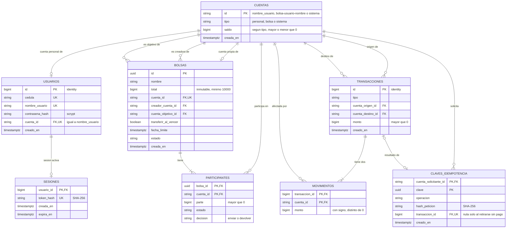

# SPEC de Cuadre

> Fuente de verdad del producto. Si `AGENTS.md` y este archivo se contradicen, se detiene el trabajo y se resuelve.
>
> **Estado:** bloques 1 a 4 cerrados (B8 a B10 se completan en los bloques 6 y 7). Bloques 5 a 11 pendientes.

## 1. Alcance y supuestos

### 1.1 Moneda y montos

- Todos los montos son enteros en pesos colombianos (COP), sin centavos.
- La API solo acepta enteros JSON. `1000.0`, `"1000"` y `1e3` se rechazan con 422, sin conversión ni redondeo.
- El error de formato es responsabilidad de quien envía la petición, sea el frontend o un cliente directo de la API.

### 1.2 Usuarios y cuentas

- Cada usuario tiene exactamente una cuenta de tipo `personal`, creada en la misma transacción que el usuario.
- Tipos de cuenta: `personal`, `bolsa` y `sistema`.
- No hay retiros de dinero hacia fuera del sistema. Si se agregaran, serían un movimiento de la cuenta del usuario hacia la cuenta de sistema, con las mismas validaciones de una transferencia.

### 1.3 Cuenta de sistema

- Existe una sola, creada por migración. Es la contrapartida de toda carga de saldo.
- Cargar $X genera dos movimientos: +X en la cuenta del usuario y −X en la cuenta de sistema.
- Su saldo es el negativo de todo lo cargado: lo que el sistema les debe a los usuarios. Por eso la suma de los saldos de todas las cuentas es siempre cero.
- Restricciones de saldo:
  - Cuenta `sistema`: `saldo <= 0`.
  - Cuentas `personal` y `bolsa`: `saldo >= 0`.
- Se bloquea con `SELECT ... FOR UPDATE` como cualquier otra cuenta, así que las cargas simultáneas se procesan en fila. Es una limitación aceptada por tiempo y se declara como mejora futura.

### 1.4 Autenticación

**Contraseñas**
- Se guardan solo como hash lento con sal (`scrypt`, de la librería estándar). Nunca en claro.
- El login calcula el hash de la contraseña recibida y lo compara con el guardado.

**Sesiones y tokens**
- Un login exitoso genera un token aleatorio y lo devuelve una sola vez al cliente.
- En la base solo se guarda el hash SHA-256 del token. En cada petición el backend calcula el hash del token recibido y busca la sesión.
- El token viaja en cada petición en la cabecera `Authorization: Bearer <token>`.
- Una sola sesión activa por usuario: un login nuevo reemplaza la sesión anterior. La tabla de sesiones tiene `UNIQUE` sobre el usuario, para que dos logins simultáneos no dejen dos tokens válidos.
- El token expira 20 minutos después del login. Las peticiones normales no extienden el plazo.
- Renovación explícita: mientras el token siga vigente, el usuario puede pedir que se restablezcan los 20 minutos (la app le ofrece un botón para continuar cuando queda poco tiempo). La renovación conserva el mismo token y mueve su expiración a `ahora + 20 minutos`.
- Un token expirado no se puede renovar: el usuario inicia sesión otra vez y recibe un token nuevo.
- La expiración se compara con `ahora` (regla 10 del dinero), sin procesos que borren tokens.
- Cerrar sesión borra la sesión.
- Token ausente, inexistente o expirado: 401.

**Idempotencia y sesiones**
- La clave de idempotencia se asocia al usuario, no a la sesión: `UNIQUE (usuario_id, clave)`.
- Si el token expira entre una petición y su reintento, el cliente inicia sesión de nuevo, reintenta con la misma clave y recibe el resultado original sin mover dinero otra vez.

### 1.5 Límites

| Límite | Valor |
| --- | --- |
| Tope por carga, transferencia o aporte (operaciones que inicia un usuario) | $50.000.000 |
| Tope de devoluciones y de la transferencia final (movimientos que deriva el sistema) | Sin tope |
| Saldo máximo por cuenta | Sin tope |
| Participantes por bolsa | Entre 2 y 50 (constante configurable) |
| Total mínimo de una bolsa | $10.000, validado solo al crearla |
| Parte máxima por participante | $50.000.000, incluido el sobrante del creador |
| Total máximo de una bolsa | ($50.000.000 − $10.000) × participantes ($2.499.500.000 con 50) |

- Con estos límites cada parte es de al menos $200, así que ninguna parte es cero.
- Los retiros bajan la meta, pero nunca la dejan en cero mientras quede un participante. Si se retiran todos, se aplica la regla 5 de las bolsas.
- El tope por operación mantiene todos los saldos lejos de 2^53, el límite de enteros exactos en JavaScript.
- Una devolución nunca se rechaza por tope ni por saldo máximo.

### 1.6 Cuenta objetivo de las bolsas

- Se fija al crear la bolsa y no cambia.
- Puede ser cualquier cuenta `personal`, incluida la del creador. Nunca una cuenta `bolsa` ni la de sistema.
- Cada invitado ve los términos antes de entrar: su parte, el total, la cuenta objetivo, la fecha límite y la política de vencimiento.

### 1.7 Cancelación y vencimiento con devolución

- Se ejecutan como una transacción por participante, todas seguidas y sin esperar confirmación.
- Cada devolución respeta el orden de bloqueo: primero la fila de la bolsa y después sus dos cuentas por id ascendente.
- Lo que se le debe a cada participante se calcula desde el libro (aportes menos devoluciones), así que una devolución repetida o retomada no puede pagar de más.
- El estado intermedio (cancelada con saldo mayor que cero) y la reanudación tras una caída se definen en los bloques 6 y 7.

### 1.8 Preguntas abiertas del bloque 1

- **Credenciales:** ¿nombre de usuario o correo como identificador? Se define en el bloque 3.

---

## 2. Arquitectura

### 2.1 Capas

| Capa | Responsabilidad | No puede |
| --- | --- | --- |
| `api/` | Extrae el token y `Idempotency-Key` de las cabeceras, valida la forma (Pydantic estricto), lee `ahora`, entrega la sesión de base de datos y traduce excepciones a HTTP | Abrir transacciones, consultar, decidir reglas, hacer `commit` |
| `services/` | Dueño de la transacción: autentica, verifica la idempotencia, bloquea, lee el estado ya bloqueado, llama a `domain/`, escribe en el libro, confirma y reintenta. El servicio del libro contable es el único que inserta movimientos y cambia saldos | Importar FastAPI, leer la hora |
| `domain/` | Reglas puras: división, estados de la bolsa, validación de montos y tope, permisos con ids ya leídos | Importar SQLAlchemy o FastAPI, leer la hora |
| `db/` | Modelos, sesión, migraciones y restricciones | Lógica de negocio |

- La API solo recibe, valida la forma y delega. El servicio decide y escribe.
- Los únicos puntos que leen el reloj son la API y el hilo del barrido. Todo lo demás recibe `ahora`.
- Una prueba verifica que `domain/` no importa `sqlalchemy` ni `fastapi`, y que `services/` no importa `fastapi`.
- Saldo e historial también pasan por el servicio, en transacciones de solo lectura.

### 2.2 Flujo de una petición


Si el primer intento con una clave aún no confirma, el duplicado espera en el `INSERT` (lo hace el índice único) y después ve el resultado. Si el primero revierte, el duplicado inserta la clave y ejecuta la operación.

### 2.3 Transacción y reintentos

- Una sesión de base de datos por petición, creada por la API y nunca compartida entre hilos. La API no hace `commit`.
- Cada caso de uso, incluidas las lecturas, abre su transacción y la confirma o revierte. Aislamiento `READ COMMITTED`.
- La autenticación es el primer paso dentro de la transacción: sin sesión válida, 401 y `ROLLBACK`.
- Un envoltorio repite el caso de uso completo, autenticación incluida, solo ante `40P01` y `40001`, máximo 3 veces. Si se agotan: 503 `reintentos_agotados`, y el cliente puede repetir con la misma clave.
- Los errores de negocio y de validación no se reintentan.

### 2.4 Orden dentro de una operación

1. Sesión, solo lectura, sin bloqueo.
2. Clave de idempotencia, con `INSERT ... ON CONFLICT`.
3. Fila de la bolsa, con `FOR UPDATE`, si la operación toca una.
4. Cuentas por id ascendente, con `FOR UPDATE`, incluida la de quien paga.
5. Leer el estado, decidir en `domain/`, escribir en el libro y confirmar.

Nunca se bloquean dos bolsas en una misma transacción. Los ciclos solo podrían aparecer si algo rompe este orden.

### 2.5 Idempotencia

- El cliente genera un UUID v4 por cada intención del usuario y lo reutiliza en los reintentos. Viaja en `Idempotency-Key` y es obligatoria en toda operación que mueve dinero. Si falta: 400 `falta_clave_idempotencia`.
- Se guarda `UNIQUE (usuario_id, clave)`, el hash SHA-256 de (operación + ids de la ruta + cuerpo en forma canónica) y la referencia a la transacción del libro. El usuario ya está en la restricción, así que no entra en el hash.
- Misma clave y mismo hash: se devuelve el resultado original, reconstruido desde el libro. Nunca un error.
- Misma clave y otro hash: 409 `clave_reutilizada`.
- La clave solo persiste si la transacción confirma. Si la operación se rechaza y revierte, la clave queda libre.
- La verificación es un `INSERT ... ON CONFLICT`, nunca un `SELECT` seguido de un `INSERT`: la restricción `UNIQUE` es lo que cierra la carrera entre peticiones simultáneas.
- Las operaciones que origina el sistema (devoluciones del barrido) usan claves deterministas, definidas en el bloque 3.

### 2.6 Errores y HTTP

**Regla no negociable.** Si la petición es inválida por sí sola, sin importar el estado de ningún recurso, es **422**. Si la petición es válida pero choca con el estado actual de un recurso o con una regla que depende de ese estado, es **409**. Las dos categorías no se mezclan.

Todos los errores salen como `{"codigo": "...", "mensaje": "..."}`. El frontend y las pruebas usan `codigo`, no el número ni el texto.

| Situación | HTTP | `codigo` |
| --- | --- | --- |
| Forma inválida (decimal, texto, falta un campo) | 422 | `forma_invalida` |
| Monto cero o negativo | 422 | `monto_invalido` |
| Monto sobre el tope | 422 | `sobre_el_tope` |
| Transferencia a uno mismo | 422 | `transferencia_a_si_mismo` |
| Falta `Idempotency-Key` | 400 | `falta_clave_idempotencia` |
| Token ausente, inexistente o expirado; credenciales inválidas | 401 | `no_autenticado` |
| No figura en la bolsa o no es el creador | 403 | `sin_permiso` |
| Cuenta o bolsa inexistente | 404 | `no_encontrado` |
| Saldo insuficiente | 409 | `saldo_insuficiente` |
| Fecha límite pasada | 409 | `fuera_de_plazo` |
| Bolsa cerrada, ya pagó u otro estado que lo impide | 409 | `estado_invalido` |
| Misma clave con otro cuerpo | 409 | `clave_reutilizada` |
| Reintentos agotados | 503 | `reintentos_agotados` |

- Quien no figura en la bolsa y quien figura sin ser el creador reciben el mismo 403. Es un tradeoff aceptado: se confirma que la bolsa existe, pero los ids son UUID y no se pueden recorrer probando números.
- Debe existir una ruta para que un invitado vea los términos de la bolsa antes de entrar.
- Saldo insuficiente es 409 porque se decide con el estado de la cuenta, aunque el usuario pueda arreglarlo cargando saldo.

### 2.7 Tiempo y vencimiento

- Una operación sobre una bolsa con `ahora >= fecha_limite` que aún no se liquidó se rechaza con 409 `fuera_de_plazo` y no mueve dinero. Detectarlo no cuesta una consulta extra, porque la bolsa ya está bloqueada y leída.
- Ninguna petición liquida una bolsa. Las peticiones son livianas y un `GET` nunca escribe en el libro.
- La base muestra la bolsa como abierta hasta el siguiente barrido (hasta 60 s), así que el frontend calcula "vencida" con la hora.
- El borde exacto (`>=` o `>`) se confirma en el bloque 6.

### 2.8 Barrido de vencidas

- `procesar_vencidas(ahora)` vive en `services/`. Lista las candidatas sin bloquear y cada paso es una transacción propia que bloquea la bolsa y relee su estado.
- Hace dos trabajos: aplicar la política a las bolsas vencidas sin completar, y retomar las que quedaron a medias.
  - `transferir`: una transacción envía lo reunido a la cuenta objetivo y cierra la bolsa.
  - `devolver`: una transacción por participante con deuda mayor que cero, y al final una que cierra la bolsa con saldo cero.
- Deuda de un participante = aportes menos devoluciones de esa bolsa, calculada desde el libro y **por tipo de transacción**, no por el par de cuentas. La cuenta objetivo puede ser la de un participante, y contar la transferencia final como devolución le restaría de más.
- Si la deuda es mayor que cero se devuelve. Si es cero no se mueve nada. Si fuera negativa es un error que se reporta y no mueve dinero.
- Si una bolsa falla, las demás siguen y la fallida se reintenta en el siguiente ciclo. No hay cola de pendientes: el estado en la base es la cola.
- Repetir el barrido es seguro porque cada paso relee la deuda tras bloquear.

### 2.9 Hilo del barrido

- Es un hilo del mismo proceso de FastAPI, iniciado en el `lifespan` de la aplicación. No es un proceso aparte: comparte memoria y pool de conexiones con la API, y muere con el proceso.
- Un solo bucle: ejecuta el ciclo completo, espera 60 s y repite. Sin solapamiento entre ciclos.
- Condiciones:
  1. Un solo worker de uvicorn. Con varios correrían varios bucles: sería seguro, pero ruidoso.
  2. Sesión propia en cada ciclo, sin estado compartido con las peticiones.
  3. Captura de excepciones por bolsa y por ciclo, con log, para que un error no mate el hilo.
  4. Intervalo en variable de entorno (60 s por defecto) y bandera para apagarlo en las pruebas, que llaman a `procesar_vencidas(ahora)` con hora fija.
  5. El pool tiene capacidad para al menos una conexión del barrido, además de las peticiones.
- Se acepta que si el proceso muere a mitad de un ciclo, la transacción en curso se revierte y las bolsas pendientes esperan al siguiente arranque. Se acepta también el costo de un barrido constante, a cambio de peticiones livianas y de no dejar bolsas eternas.
- Ningún endpoint recibe la hora. Para la demo se crea una bolsa con fecha límite a un par de minutos y se espera al barrido.

### 2.10 Entradas para los bloques siguientes

- **Bloque 3:** tipo de cada transacción (`carga`, `transferencia`, `aporte`, `devolucion`, `transferencia_final` y el envío por decisión), qué guarda la fila de idempotencia cuando la operación no crea una transacción del libro (crear bolsa), y las claves deterministas de las devoluciones del sistema.
- **Bloque 7:** orden de cierre de una cancelación con política `transferir`: primero se devuelven los aportes de quienes decidieron devolver, después se transfiere en una sola operación lo que queda en la bolsa y se cierra. Precondición: ningún participante con una devolución decidida y pendiente. El plazo para decidir y el valor por defecto siguen abiertos.
- **Bloque 9:** `aportar` no lleva monto en el cuerpo (decidido): el servidor conoce la parte del participante, así que no existe el error "pago distinto de la parte exacta" por esa vía.

### 2.11 Preguntas del bloque 2 ya resueltas

- El hilo del barrido es un solo bucle: duerme 60 s, ejecuta el barrido y repite. Termina junto con el proceso (hilo daemon).
- `aportar` no lleva monto en el cuerpo. Por ahora todos los participantes pagan lo mismo (se revisa en el bloque 3, por su efecto en el modelo, y en el bloque 6).

---

## 3. Modelo de datos

Imagen del diagrama: `docs/modelo-datos.png`.

### 3.1 Principios

- **Regla no negociable del valor:** todo lo que mueve valor es una transacción con una cuenta de origen y una de destino distintas y un monto positivo. Nada aparece ni desaparece: todo sale de una cuenta y llega a otra. Cargar saldo sale de la cuenta de sistema.
- La base impone todo lo que se puede expresar con tipos, `NOT NULL`, `CHECK`, `UNIQUE` y llaves foráneas. No hay triggers.
- El servicio del libro verifica antes de confirmar lo que la base no expresa sin triggers (suma cero de cada transacción y tipos de cuenta permitidos). Si algo no cuadra, revierte.
- `make check` detecta después cualquier violación de lo que solo impone el servicio. Las consultas se escriben en el bloque 4.
- Las fechas de negocio las escribe el servicio con `ahora`. No hay `DEFAULT now()`.
- Estados y valores cerrados son `text` con `CHECK`, nunca `ENUM` de PostgreSQL.
- Toda restricción tiene nombre explícito (`ck_`, `uq_`, `fk_`, `ix_`), para que los errores sean legibles y la API pueda traducirlos.

### 3.2 Diagrama



### 3.3 Identificadores

| Entidad | Id | Formato |
| --- | --- | --- |
| Usuario | `bigint` identity | Generado por la base. Interno |
| Cuenta personal | `text` | Igual al nombre de usuario: `^[a-z0-9_]{3,30}$`, distinto de `sistema` |
| Cuenta de bolsa | `text` | `bolsa-<nombre de usuario del creador>-<nombre de la bolsa>` |
| Cuenta de sistema | `text` | `sistema` |
| Bolsa | `uuid` | Generado por la base. Es el id que expone la API |
| Transacción | `bigint` identity | Generado por la base |

- Ningún segmento admite `-`, así que un id de bolsa nunca se confunde con otro ni con uno personal. Sin esa regla, `ana-maria` + `x` y `ana` + `maria-x` darían el mismo id.
- `sistema` es un nombre de usuario reservado.
- El nombre de usuario y el nombre de la bolsa forman parte de ids, así que nunca cambian.
- Un creador no puede repetir el nombre de una bolsa, aunque la anterior esté cerrada: lo impide la llave primaria de la cuenta.
- Los ids de cuenta son ASCII y la columna usa `COLLATE "C"` (orden por bytes). Así, el orden de bloqueo por id ascendente es el mismo en PostgreSQL y en Python.
- Para transferir, el cliente envía el id de la cuenta destino, es decir, el nombre de usuario del destinatario.

### 3.4 Tablas

#### `cuentas`

| Columna | Tipo | Restricciones |
| --- | --- | --- |
| `id` | `text COLLATE "C"` | PK |
| `tipo` | `text` | `NOT NULL`, `ck_cuentas_tipo`: `tipo IN ('personal', 'bolsa', 'sistema')` |
| `saldo` | `bigint` | `NOT NULL DEFAULT 0` |
| `creada_en` | `timestamptz` | `NOT NULL` |

- `ck_cuentas_formato_id`: `(tipo = 'personal' AND id ~ '^[a-z0-9_]{3,30}$' AND id <> 'sistema') OR (tipo = 'bolsa' AND id ~ '^bolsa-[a-z0-9_]{3,30}-[a-z0-9_]{1,40}$') OR (tipo = 'sistema' AND id = 'sistema')`.
- `ck_cuentas_saldo`: `(tipo = 'sistema' AND saldo <= 0) OR (tipo <> 'sistema' AND saldo >= 0)`.
- Como el id de la cuenta de sistema es fijo, solo puede existir una.
- Como el formato del id depende del tipo, cualquier llave foránea que exija formato personal apunta, por construcción, a una cuenta personal.
- Solo el servicio del libro contable modifica `saldo`.

#### `usuarios`

| Columna | Tipo | Restricciones |
| --- | --- | --- |
| `id` | `bigint` | PK, `GENERATED ALWAYS AS IDENTITY` |
| `cedula` | `text` | `NOT NULL`, `UNIQUE`, `ck_usuarios_cedula`: `cedula ~ '^[0-9]{5,10}$'` |
| `nombre_usuario` | `text COLLATE "C"` | `NOT NULL`, `UNIQUE`, `ck_usuarios_nombre`: `nombre_usuario ~ '^[a-z0-9_]{3,30}$' AND nombre_usuario <> 'sistema'` |
| `contrasena_hash` | `text` | `NOT NULL` |
| `cuenta_id` | `text COLLATE "C"` | `NOT NULL`, `UNIQUE`, FK a `cuentas(id)` |
| `creado_en` | `timestamptz` | `NOT NULL` |

- `ck_usuarios_cuenta`: `cuenta_id = nombre_usuario`. Ese formato solo es válido para cuentas personales, así que un usuario siempre apunta a su cuenta personal.
- El usuario depende de la cuenta: no puede existir sin ella. Se crea primero la cuenta y después el usuario, en la misma transacción.
- La cédula impide que una persona tenga dos usuarios. Sin verificación de identidad, cualquiera puede registrar una cédula ajena (riesgo declarado).

#### `sesiones`

| Columna | Tipo | Restricciones |
| --- | --- | --- |
| `usuario_id` | `bigint` | PK, FK a `usuarios(id)` |
| `token_hash` | `text` | `NOT NULL`, `UNIQUE`, `ck_sesiones_hash`: `token_hash ~ '^[0-9a-f]{64}$'` |
| `creada_en` | `timestamptz` | `NOT NULL` |
| `expira_en` | `timestamptz` | `NOT NULL`, `ck_sesiones_expira`: `expira_en > creada_en` |

- La llave primaria sobre el usuario garantiza una sola sesión activa. El login reemplaza la fila, la renovación actualiza `expira_en` y el logout la borra. No es una tabla del libro, así que `UPDATE` y `DELETE` están permitidos.

#### `transacciones`

| Columna | Tipo | Restricciones |
| --- | --- | --- |
| `id` | `bigint` | PK, `GENERATED ALWAYS AS IDENTITY` |
| `tipo` | `text` | `NOT NULL`, `ck_transacciones_tipo`: `tipo IN ('carga', 'transferencia', 'aporte', 'devolucion', 'transferencia_final')` |
| `cuenta_origen_id` | `text COLLATE "C"` | `NOT NULL`, FK a `cuentas(id)` |
| `cuenta_destino_id` | `text COLLATE "C"` | `NOT NULL`, FK a `cuentas(id)` |
| `monto` | `bigint` | `NOT NULL`, `ck_transacciones_monto`: `monto > 0` |
| `creado_en` | `timestamptz` | `NOT NULL` |

- `ck_transacciones_cuentas_distintas`: `cuenta_origen_id <> cuenta_destino_id`.
- `uq_aporte_unico`: `UNIQUE (cuenta_origen_id, cuenta_destino_id) WHERE tipo = 'aporte'`. Un participante aporta una sola vez a una bolsa.
- `uq_devolucion_unica`: `UNIQUE (cuenta_origen_id, cuenta_destino_id) WHERE tipo = 'devolucion'`. Un participante recibe una sola devolución por bolsa.
- `uq_transferencia_final_unica`: `UNIQUE (cuenta_origen_id) WHERE tipo = 'transferencia_final'`. Es el cierre único de cada bolsa.
- Índices: `ix_transacciones_origen_tipo (cuenta_origen_id, tipo)` e `ix_transacciones_destino_tipo (cuenta_destino_id, tipo)`, para calcular deudas.
- Inmutable: el código nunca hace `UPDATE` ni `DELETE`.

#### `movimientos`

| Columna | Tipo | Restricciones |
| --- | --- | --- |
| `transaccion_id` | `bigint` | FK a `transacciones(id)` |
| `cuenta_id` | `text COLLATE "C"` | FK a `cuentas(id)` |
| `monto` | `bigint` | `NOT NULL`, `ck_movimientos_monto`: `monto <> 0` |

- PK `(transaccion_id, cuenta_id)`: no puede haber dos patas sobre la misma cuenta en una transacción.
- Índice: `ix_movimientos_cuenta (cuenta_id, transaccion_id)`, para el historial paginado.
- Cada transacción tiene exactamente dos movimientos: −monto en el origen y +monto en el destino. Lo verifica el servicio antes de confirmar.
- Inmutable: el código nunca hace `UPDATE` ni `DELETE`.

#### `claves_idempotencia`

| Columna | Tipo | Restricciones |
| --- | --- | --- |
| `cuenta_solicitante_id` | `text COLLATE "C"` | FK a `cuentas(id)`, `ck_claves_solicitante`: formato personal |
| `clave` | `uuid` | |
| `operacion` | `text` | `NOT NULL`, `ck_claves_operacion`: `operacion IN ('cargar', 'transferir', 'aportar', 'retirarse')` |
| `hash_peticion` | `text` | `NOT NULL`, `ck_claves_hash`: `hash_peticion ~ '^[0-9a-f]{64}$'` |
| `transaccion_id` | `bigint` | `UNIQUE`, FK a `transacciones(id)`, admite nulo |
| `creado_en` | `timestamptz` | `NOT NULL` |

- PK `(cuenta_solicitante_id, clave)`.
- Solo las operaciones que inicia un usuario llevan clave. Las transacciones del sistema (devoluciones del barrido y transferencia final) no la llevan: las protegen la deuda recalculada tras bloquear y los índices únicos parciales.
- La cuenta solicitante es la cuenta personal de quien hace la petición, no el origen de la transacción: al retirarse con pago, el origen es la cuenta de la bolsa.
- Flujo: la clave se inserta con `transaccion_id` nulo como primer paso, y se completa antes de confirmar. Al confirmar, solo puede quedar nula si la operación fue retirarse sin pago. Esto no puede ser un `CHECK`, porque PostgreSQL lo evaluaría en el primer `INSERT`; lo detecta `make check`.
- Si una petición crea dos transacciones (el aporte o el retiro que completa la bolsa), la clave apunta a la que pidió el usuario. La transferencia final se encuentra por `uq_transferencia_final_unica`.

#### `bolsas`

| Columna | Tipo | Restricciones |
| --- | --- | --- |
| `id` | `uuid` | PK, `DEFAULT gen_random_uuid()` |
| `nombre` | `text COLLATE "C"` | `NOT NULL`, `ck_bolsas_nombre`: `nombre ~ '^[a-z0-9_]{1,40}$'` |
| `total` | `bigint` | `NOT NULL`, `ck_bolsas_total`: `total >= 10000`. Inmutable |
| `cuenta_id` | `text COLLATE "C"` | `NOT NULL`, `UNIQUE`, FK a `cuentas(id)` |
| `creador_cuenta_id` | `text COLLATE "C"` | `NOT NULL`, FK a `cuentas(id)`, formato personal |
| `cuenta_objetivo_id` | `text COLLATE "C"` | `NOT NULL`, FK a `cuentas(id)`, formato personal |
| `transferir_al_vencer` | `boolean` | `NOT NULL`, sin valor por defecto |
| `fecha_limite` | `timestamptz` | `NOT NULL` |
| `estado` | `text` | `NOT NULL`, `CHECK` con los estados del bloque 6 |
| `creada_en` | `timestamptz` | `NOT NULL` |

- `ck_bolsas_cuenta`: `cuenta_id = 'bolsa-' || creador_cuenta_id || '-' || nombre`.
- `ck_bolsas_fecha`: `fecha_limite > creada_en`.
- Políticas: una bandera booleana por política, `NOT NULL` y sin valor por defecto, para que el creador la elija siempre. Hoy hay una: `transferir_al_vencer` (verdadero transfiere lo reunido, falso lo devuelve), que también decide la cancelación. Una política nueva se agrega como columna nueva, con un valor por defecto igual al comportamiento actual para que las bolsas existentes no cambien.
- Configuración inmutable: el código solo cambia `estado`.
- Índice parcial para el barrido: `ix_bolsas_vencimiento (fecha_limite) WHERE` el estado no es final (bloque 6).

#### `participantes`

| Columna | Tipo | Restricciones |
| --- | --- | --- |
| `bolsa_id` | `uuid` | FK a `bolsas(id)` |
| `cuenta_id` | `text COLLATE "C"` | FK a `cuentas(id)`, `ck_participantes_cuenta`: formato personal |
| `parte` | `bigint` | `NOT NULL`, `ck_participantes_parte`: `parte > 0` |
| `estado` | `text` | `NOT NULL`, `CHECK` con los estados del bloque 6 |
| `decision` | `text` | Admite nulo, `ck_participantes_decision`: `decision IN ('enviar', 'devolver')` |

- PK `(bolsa_id, cuenta_id)`. Un participante se identifica por su cuenta personal, igual que el creador.
- Índice: `ix_participantes_cuenta (cuenta_id)`, para "mis bolsas".
- Solo cambian `estado` y `decision`. La parte es inmutable.

### 3.5 Tipos de cuenta permitidos por transacción

Lo valida el servicio antes de escribir y lo detecta `make check`. Por simplicidad y tiempo, la base no lo impone: el tipo de cada cuenta ya está en `cuentas` y no se duplica en `transacciones`.

| Tipo | Origen | Destino |
| --- | --- | --- |
| `carga` | sistema | personal |
| `transferencia` | personal | personal |
| `aporte` | personal | bolsa |
| `devolucion` | bolsa | personal |
| `transferencia_final` | bolsa | personal |

### 3.6 Deuda de un participante

Deuda de un participante en una bolsa = monto de su `aporte` (origen su cuenta, destino la cuenta de la bolsa) menos el de su `devolucion` (el recorrido inverso). Se calcula desde el libro y por tipo, así que la transferencia final nunca se confunde con una devolución aunque la cuenta objetivo sea de un participante. Por los índices únicos, la deuda solo puede valer 0 o la parte.

### 3.7 División y sobrante

- Base = total ÷ N (división entera). Resto = total mod N, que con N ≤ 50 es como máximo $49.
- Cada participante paga la base, y el creador paga la base más el resto.
- La suma de las partes es siempre igual al total (propiedad de Hypothesis).
- El creador siempre es participante.
- El total se guarda en `bolsas.total` y no cambia. El máximo N × ($50.000.000 − $10.000) lo valida `domain/` al crear y lo verifica la invariante B3.
- El total máximo de una bolsa es N × ($50.000.000 − $10.000). Como el resto es como máximo $49, la parte del creador nunca supera el tope de $50.000.000.

### 3.8 Reglas que solo impone el servicio

| Regla | Cómo la cumple el servicio | Cómo la detecta `make check` |
| --- | --- | --- |
| Dos patas que suman cero y coinciden con la cabecera | Construye ambas patas desde origen, destino y monto, y verifica antes de confirmar | Transacciones sin dos movimientos, con suma distinta de 0 o con patas que no coinciden |
| Saldo igual a la suma de movimientos | Actualiza el saldo en la misma transacción que el movimiento | Cuentas cuyo saldo difiere de la suma de sus movimientos |
| Tipos de cuenta por transacción | Valida antes de escribir | Transacciones fuera de la tabla 3.5 |
| Partes que suman el total, creador participante, de 2 a 50 participantes | `domain/` al crear la bolsa | Bolsas que no cumplen |
| Deuda nunca negativa | La recalcula tras bloquear | Pares con devolución sin aporte |
| Toda cuenta personal tiene usuario | Crea ambos en la misma transacción | Cuentas personales sin usuario |
| Clave con transacción | La completa antes de confirmar | Claves nulas en operaciones distintas de retirarse |
| Inmutabilidad del libro y de la configuración | No hay `UPDATE` ni `DELETE` en el código | No se detecta con consultas. Riesgo aceptado: se cuida en la revisión del código |

### 3.9 Cómo se comprueba que una transacción es válida

Se verifica **cada transacción por separado**, nunca con un acumulado global.

1. **Por transacción:** dos movimientos, −monto en el origen y +monto en el destino. Lo verifica el servicio antes de confirmar y `make check` después.
2. **Por cuenta:** el saldo es igual a la suma de sus movimientos.
3. **Global:** la suma de todos los saldos es cero. Se calcula al momento con una consulta y no se guarda.

Un contador global de la suma de movimientos no sirve, por tres razones:
- Todas las transacciones lo actualizarían, así que sería una fila por la que pasaría todo en fila, como la cuenta de sistema.
- Dos errores que se compensan (+5 en una transacción y −5 en otra) lo dejan en cero y esconden ambos.
- Si no es cero, no dice qué transacción falló.

Las consultas de los niveles 1 y 2 devuelven la lista de transacciones o cuentas que fallan. Cero filas significa que todo cuadra, y cualquier fila dice exactamente dónde está el error.

### 3.10 Preguntas del bloque 3 ya resueltas

- **Tope de la parte del creador:** el total máximo de una bolsa es N × ($50.000.000 − $10.000), así que la parte del creador nunca supera el tope (3.7).
- **Tipos de cuenta por transacción:** los valida solo el servicio, sin `CHECK` en la base. Decisión por simplicidad y tiempo (3.5).
- **Claves de idempotencia:** solo las operaciones de usuario llevan clave. Toda operación de dinero, de usuario o del sistema, queda registrada con el id de su transacción.
- **Participantes:** apuntan a la cuenta personal, igual que el creador (3.4).
- **Inmutabilidad:** no se usa un usuario de base de datos con permisos restringidos. La regla 5 la cuida el código y su revisión (3.8).

---

## 4. Invariantes

### 4.1 Cómo se verifican

- Una invariante es algo que debe ser cierto siempre. Cada una tiene una consulta que devuelve las filas que la violan: cero filas significa que se cumple.
- `make check` corre todas las consultas dentro de una sola transacción `REPEATABLE READ READ ONLY`, para que el reporte describa un mismo instante aunque haya operaciones en curso.
- Salida: una línea por invariante con su id, `PASA` o `FALLA`, el número de filas y los primeros ids que fallan. Si alguna falla, el código de salida es distinto de cero, y la integración continua lo detecta.
- Las consultas viven en `backend/app/db/invariantes.py`: una lista con id, descripción y SQL de solo lectura. La usan `make check` y las pruebas.
- Toda prueba que toca la base termina corriendo todas las invariantes. Si alguna falla, la prueba falla. Es indispensable al final de las pruebas de concurrencia.
- Alcance: solo lo que impone el servicio. Lo que ya garantiza la base (`CHECK`, `UNIQUE`, llaves foráneas) no se repite; lo cubren las pruebas que intentan violar cada restricción.
- Límites declarados: las consultas recorren tablas completas (con más volumen se verificaría solo lo nuevo desde la última revisión), y no hay pruebas que inserten violaciones a propósito para comprobar que cada consulta las detecta.

### 4.2 Libro contable

**L1. Cada transacción tiene exactamente dos movimientos** (regla 3).

```sql
SELECT t.id
FROM transacciones t
LEFT JOIN movimientos m ON m.transaccion_id = t.id
GROUP BY t.id
HAVING count(m.cuenta_id) <> 2;
```

**L2. Las patas coinciden con la cabecera: −monto en el origen y +monto en el destino.** Junto con L1 implica la suma cero (regla 3).

```sql
SELECT t.id
FROM transacciones t
WHERE NOT EXISTS (
        SELECT 1 FROM movimientos m
        WHERE m.transaccion_id = t.id
          AND m.cuenta_id = t.cuenta_origen_id
          AND m.monto = -t.monto)
   OR NOT EXISTS (
        SELECT 1 FROM movimientos m
        WHERE m.transaccion_id = t.id
          AND m.cuenta_id = t.cuenta_destino_id
          AND m.monto = t.monto);
```

**L3. El saldo de cada cuenta es igual a la suma de sus movimientos** (reglas 2 y 5).

```sql
SELECT c.id, c.saldo, COALESCE(sum(m.monto), 0) AS suma_movimientos
FROM cuentas c
LEFT JOIN movimientos m ON m.cuenta_id = c.id
GROUP BY c.id, c.saldo
HAVING c.saldo <> COALESCE(sum(m.monto), 0);
```

**L4. La suma de todos los saldos es cero** (regla 3).

```sql
SELECT sum(saldo) AS suma_saldos
FROM cuentas
HAVING sum(saldo) <> 0;
```

**L5. Cada transacción respeta los tipos de cuenta de la tabla 3.5** (regla 1 de las bolsas).

```sql
SELECT t.id, t.tipo, o.tipo AS tipo_origen, d.tipo AS tipo_destino
FROM transacciones t
JOIN cuentas o ON o.id = t.cuenta_origen_id
JOIN cuentas d ON d.id = t.cuenta_destino_id
WHERE (t.tipo, o.tipo, d.tipo) NOT IN (VALUES
    ('carga', 'sistema', 'personal'),
    ('transferencia', 'personal', 'personal'),
    ('aporte', 'personal', 'bolsa'),
    ('devolucion', 'bolsa', 'personal'),
    ('transferencia_final', 'bolsa', 'personal'));
```

**L6. Toda cuenta personal tiene usuario y toda cuenta de bolsa tiene su bolsa** (modelo).

```sql
SELECT c.id
FROM cuentas c
LEFT JOIN usuarios u ON u.cuenta_id = c.id
LEFT JOIN bolsas b ON b.cuenta_id = c.id
WHERE (c.tipo = 'personal' AND u.id IS NULL)
   OR (c.tipo = 'bolsa' AND b.id IS NULL);
```

**L7. Cada clave de idempotencia es coherente con su transacción** (regla 7). `retirarse` es la única operación que puede no tener transacción.

```sql
SELECT k.cuenta_solicitante_id, k.clave, k.operacion
FROM claves_idempotencia k
LEFT JOIN transacciones t ON t.id = k.transaccion_id
WHERE (
       (k.operacion = 'cargar'     AND t.tipo = 'carga'         AND t.cuenta_destino_id = k.cuenta_solicitante_id)
    OR (k.operacion = 'transferir' AND t.tipo = 'transferencia' AND t.cuenta_origen_id  = k.cuenta_solicitante_id)
    OR (k.operacion = 'aportar'    AND t.tipo = 'aporte'        AND t.cuenta_origen_id  = k.cuenta_solicitante_id)
    OR (k.operacion = 'retirarse'  AND (t.id IS NULL
          OR (t.tipo = 'devolucion' AND t.cuenta_destino_id = k.cuenta_solicitante_id)))
) IS NOT TRUE;
```

`IS NOT TRUE` es necesario: sin él, una clave sin transacción daría `NULL` en la condición y no aparecería como violación.

**L8. Ninguna carga, transferencia ni aporte supera el tope** (regla 11).

```sql
SELECT t.id, t.tipo, t.monto
FROM transacciones t
WHERE t.tipo IN ('carga', 'transferencia', 'aporte')
  AND t.monto > 50000000;
```

### 4.3 Bolsas

**B1. Cada bolsa tiene entre 2 y 50 participantes.** Los retiros no borran filas, así que el conteo es el de la creación.

```sql
SELECT b.id
FROM bolsas b
LEFT JOIN participantes p ON p.bolsa_id = b.id
GROUP BY b.id
HAVING count(p.cuenta_id) NOT BETWEEN 2 AND 50;
```

**B2. El creador es participante.**

```sql
SELECT b.id
FROM bolsas b
WHERE NOT EXISTS (
    SELECT 1 FROM participantes p
    WHERE p.bolsa_id = b.id AND p.cuenta_id = b.creador_cuenta_id);
```

**B3. Las partes respetan la división y el total** (regla 9). Las partes suman el total, todas valen total ÷ N salvo la del creador, que suma el resto, y el total no supera N × ($50.000.000 − $10.000).

```sql
WITH n AS (
    SELECT bolsa_id, count(*) AS n, sum(parte) AS suma
    FROM participantes
    GROUP BY bolsa_id
)
SELECT b.id
FROM bolsas b
JOIN n ON n.bolsa_id = b.id
WHERE n.suma <> b.total
   OR b.total > n.n * 49990000
   OR EXISTS (
        SELECT 1 FROM participantes p
        WHERE p.bolsa_id = b.id
          AND p.parte <> CASE
                WHEN p.cuenta_id = b.creador_cuenta_id THEN b.total / n.n + b.total % n.n
                ELSE b.total / n.n
              END);
```

**B4. Cada aporte viene de un participante de esa bolsa y es exactamente su parte** (reglas 3 y 4 de las bolsas).

```sql
SELECT t.id
FROM transacciones t
LEFT JOIN bolsas b ON b.cuenta_id = t.cuenta_destino_id
LEFT JOIN participantes p ON p.bolsa_id = b.id AND p.cuenta_id = t.cuenta_origen_id
WHERE t.tipo = 'aporte'
  AND (b.id IS NULL OR p.cuenta_id IS NULL OR t.monto <> p.parte);
```

**B5. Cada devolución va a un participante que aportó, por exactamente lo que aportó** (regla 8 de las bolsas). Por el índice único, cada par tiene como máximo un aporte.

```sql
SELECT t.id
FROM transacciones t
LEFT JOIN transacciones a
       ON a.tipo = 'aporte'
      AND a.cuenta_origen_id = t.cuenta_destino_id
      AND a.cuenta_destino_id = t.cuenta_origen_id
WHERE t.tipo = 'devolucion'
  AND (a.id IS NULL OR a.monto <> t.monto);
```

**B6. La transferencia final va a la cuenta objetivo por exactamente lo que quedaba, y la bolsa queda en cero** (reglas 5 y 9 de las bolsas).

```sql
SELECT t.id
FROM transacciones t
LEFT JOIN bolsas b ON b.cuenta_id = t.cuenta_origen_id
LEFT JOIN cuentas c ON c.id = b.cuenta_id
WHERE t.tipo = 'transferencia_final'
  AND (b.id IS NULL
       OR t.cuenta_destino_id <> b.cuenta_objetivo_id
       OR c.saldo <> 0
       OR t.monto <> (
            SELECT COALESCE(sum(CASE WHEN x.tipo = 'aporte' THEN x.monto ELSE -x.monto END), 0)
            FROM transacciones x
            WHERE (x.tipo = 'aporte' AND x.cuenta_destino_id = b.cuenta_id)
               OR (x.tipo = 'devolucion' AND x.cuenta_origen_id = b.cuenta_id)));
```

**B7. Ningún aporte es posterior a la fecha límite** (regla 4 de las bolsas). El borde exacto se confirma en el bloque 6.

```sql
SELECT t.id
FROM transacciones t
JOIN bolsas b ON b.cuenta_id = t.cuenta_destino_id
WHERE t.tipo = 'aporte'
  AND t.creado_en >= b.fecha_limite;
```

### 4.4 Invariantes pendientes de los bloques 6 y 7

| Id | Invariante | Se escribe en |
| --- | --- | --- |
| B8 | Toda bolsa en estado final tiene saldo cero | Bloque 6 |
| B9 | El estado coincide con el libro: una bolsa abierta no tiene transferencia final ni la meta reunida, y un participante retirado tiene deuda cero | Bloque 6 |
| B10 | Solo hay decisiones en bolsas canceladas con `transferir_al_vencer` | Bloque 7 |
